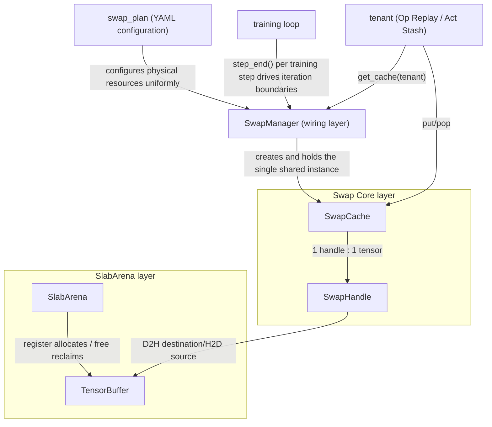
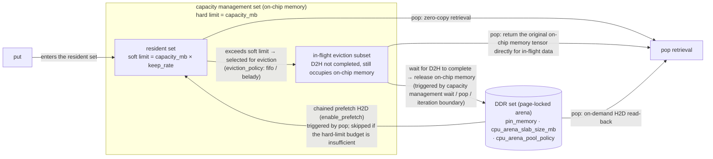

# Swap Core (Tensor Swap Foundation)

## Applicable Backends

FSDP2

## Background and Challenges

In long-sequence training of large models, activation memory is one of the main bottlenecks. Memory optimization methods such as recomputation and activation offload all involve on-chip memory↔DDR data movement, but existing implementations (per-operator recomputation skipping, per-layer activation offload, and so on) are self-managed private mechanisms: each feature maintains its own private swap-out logic and release protocol, and on-chip memory and page-locked memory resources are invisible to each other and difficult to orchestrate in a unified way.

## Solution

Swap Core is a general-purpose foundation for asynchronous on-chip memory↔DDR swap-in and swap-out (swap), and consists of two layers:

- **SlabArena**: A CPU-side page-locked memory slab allocator that supports two forms: pooled reuse (slab pool) and exact on-demand allocation;
- **SwapCache/SwapHandle**: Single-tensor swap-in/swap-out and set management, providing dual capacity thresholds (hard limit + soft limit), fifo/belady eviction, and transition-graph-based chained prefetch.

Physical resources (swap streams, CPU page-locked arena, and capacity budget) are configured uniformly by `swap_plan` and held at a single point by `SwapManager`. Each memory optimization feature is injected as a **tenant** through `get_cache(tenant)` and shares the same `SwapCache` instance, without building its own cache or defining its own iteration boundaries. For the tenant list, see [tenant list and selection guide](#tenant-list-and-selection-guide).

### Solution Principle

The module relationships are as follows (dependencies are unidirectional: upper layers call lower layers, and lower layers are unaware of upper layers):

The capabilities that the foundation provides externally (to tenants and users):

- **put/pop swap-in and swap-out**: put stores a tensor and returns a token (handle), and pop retrieves the tensor by token. All copies are executed asynchronously and overlap with computation, with no host blocking.
- **Unified capacity management**: All tenants share a single on-chip memory budget. Tensors whose projected occupancy exceeds the soft limit are automatically swapped out to DDR and automatically read back when retrieved.
- **Chained prefetch**: The retrieval (pop) order of the first iteration is recorded to form a transition graph; afterwards, tensors are prefetched along the transition graph before they are consumed.
- **Layout fidelity**: A retrieved tensor has exactly the same layout as the original tensor. If a normalized layout (such as `.contiguous()`) is required, compose it yourself after retrieval.

### Usage Conventions

Matters that require special agreement on the boundary between tenants and Swap Core:

- **Iteration boundaries are defined by the caller's loop**: Chained prefetch relies on a repeatable loop structure: the transition graph learns the retrieval order in the first iteration, and subsequent iterations prefetch along the graph. Therefore, the cache closes out per "iteration": at the end of each iteration it clears the content swapped out in that iteration (releasing handles and occupancy counts) and advances transition graph learning. An iteration does not necessarily correspond to a training step; the integrating party drives it at its own loop granularity. The FSDP2 trainer in this repository has already been integrated automatically per training step.
- **Swapped-out tensors must not be modified in place (no runtime fallback)**: A tensor that enters the cache must not be modified in place before it is retrieved. Violations do not raise errors but silently produce incorrect values (that is, incorrect gradients in training scenarios), and the cache layer performs no version detection. If modification is really required, call `clone()` first.
- **put is called in the context of the allocation stream**: All writes to a tensor must be ordered before put. Writes previously performed on side streams must be relayed by the tenant into the stream where put runs using events first (cross-stream ordering discipline is a requirement of multi-stream programming itself, and the foundation provides no fallback).
- **pop/consume is called in the context of the consumer stream**: The retrieval landing point is allocated from the put stream pool, and when retrieval completes the foundation applies the ordering to both the consumer stream and the put stream (settle on both). Before the tenant releases the reference afterwards, it must ensure that the allocation stream is ordered after all reads on its own side streams (wait-before-drop).

## Use Cases

- **When to enable**: When activation memory becomes a bottleneck in long-sequence or large-model training and you want to trade a small on-chip memory budget plus DDR bandwidth for "key operators are not recomputed and activations do not reside in on-chip memory", integrate through the Op Replay/Act Stash tenants. 
- **When not to enable**: For short sequences or scenarios where activation memory is not under pressure, swap-in and swap-out only introduce extra D2H/H2D copy overhead. Configuring only `swap_plan` without enabling a tenant has no effect.
- **Not available**: CPU-only hosts (cache construction fails directly when any tenant is enabled).

## How to Use

`swap_plan` describes the swap physical resources shared by all tenants (on-chip memory capacity budget, CPU page-locked arena, eviction and prefetch policies). Configure it in the `features` section of the training YAML (FSDP2 backend).

### Parameter Description

| Configuration Item | Type | Default Value | Meaning and Value Constraints |
| --- | --- | --- | --- |
| `swap_plan.capacity_mb` | float | 1024.0 | The on-chip memory capacity budget (MB) shared by all tenants, which is also the cap on the physical occupancy of the cache pool. **The memory gain is determined by it: the pool physical peak ≈ min(`capacity_mb`, total swap-out volume), regardless of `keep_rate`**. Three value ranges are available: `<0` means no management (pass-through, nothing is evicted); `=0` means deterministic eviction (evict on every put, and the compute (put) stream waits for the swap stream, with no asynchronous overlap); `>0` means asynchronous capacity management (the default mode). For mechanism details, see [configuration mechanism diagram](#configuration-mechanism-diagram). |
| `swap_plan.keep_rate` | float | 0.0 | On-chip memory residency ratio, in the range `[0,1]`. Soft limit = `capacity_mb × keep_rate` (projected). Asynchronous D2H is initiated when the projected occupancy exceeds the soft limit. **It does not change the physical peak (which is capped by the hard limit); it only adjusts copy timing and retrieval hit rate**: `0` means initiate on put (maximum overlap between copy and computation, but the entire swap-out volume incurs copy overhead); `1` means keep resident as much as possible and initiate only when physical occupancy reaches the hard limit (minimum copying, and the resident part is retrieved with zero copy). A value out of range (`<0` or `>1`) causes a startup validation error. |
| `swap_plan.enable_prefetch` | bool | true | Whether to enable chained prefetch. The first iteration is used to learn the pop order of tensors (at least two retrievals are required to form the first transition edge). From the second iteration onwards, subsequent tensors are prefetched along the transition graph after a pop. |
| `swap_plan.cpu_arena_slab_size_mb` | float/null | 2048.0 | Slab size (MB) of the CPU slab arena. When set to `null` (YAML syntax), the on-demand arena is used: each tensor is allocated exactly, and the page-locked memory is returned immediately after release (no pooled reuse). |
| `swap_plan.cpu_arena_pool_policy` | string | "standard" | CPU arena pool policy: `"all"` retains the physical memory of all empty slabs; `"standard"` retains standard slabs and releases oversized slabs immediately after they become empty; `"none"` releases any slab immediately after it becomes empty. Effective only when `cpu_arena_slab_size_mb` is configured. |
| `swap_plan.pin_memory` | bool | true | Whether arena slabs use page-locked memory. `false` is the escape hatch when host page-locked memory is exhausted: non-page-locked copies degrade to synchronous execution (torch behavior). |
| `swap_plan.eviction_policy` | string | "fifo" | Eviction policy: `"fifo"` (evict the earliest inserted first) or `"belady"` (evict the tensor whose next use is farthest in the future). In the management mode with `keep_rate=0` (the default), a put triggers eviction every time, so there is no choice of "whom to evict" and the two policies are equivalent; belady takes effect when `keep_rate>0`. |

### Configuration Mechanism Diagram

The following diagram explains capacity management, eviction, and prefetch from the perspective of how configuration takes effect, and marks the point of action of each user configuration item.

Key points for reading the diagram:

- **Set relationships**: resident set ∪ in-flight eviction subset = capacity management set (both occupy on-chip memory); the DDR set is independent and is not constrained by `capacity_mb`.
- **Release timing**: Completion of the D2H copy itself does not release on-chip memory. Release is an independent host-side action that occurs only at three types of timing (capacity management waiting for in-flight D2H to complete, pop, and the iteration boundary); only after that does the tensor fall into the DDR set and does on-chip memory occupancy actually decrease.
- **Capacity sizing rule**: For asynchronous overlap to hold, the capacity must accommodate the in-flight copies. In steady state, the number of in-flight D2H copies ≈ single-copy transfer time ÷ swap-out interval (Little's law). Rule of thumb: `capacity_mb ≥ (⌈single-copy transfer time/swap-out interval⌉ + 1) × single swap-out size`. Below this lower bound, hard-limit back-pressure stalls start to surface on the forward critical path (manifesting as a longer step time while on-chip memory occupancy appears lower).

Key points (fifo versus belady):

- **Opposite criteria**: fifo takes the head of the queue by put insertion order; belady uses the "next use step" recorded in the transition graph and evicts the tensor that is used latest. This is the optimal strategy (OPT) in cache theory, on the premise that the future access order is known and stable.
- **Two preconditions for belady**: the transition graph has been learned (from the second iteration onwards) and `keep_rate > 0` (with the default `keep_rate = 0`, eviction happens on every put and the two policies are equivalent).
- **belady with variable workloads**: Tensors whose future pop position cannot be found are evicted first as "never used"; for workloads where the pop order changes from step to step, the "future" learned by the transition graph is unreliable, so it is recommended to use `enable_prefetch: false` + `eviction_policy: fifo`.

## Tenant List and Selection Guide

Configuring only `swap_plan` has no effect: the foundation itself does not produce memory gains; the gains come from the tenants on top of it, so at least one tenant must be enabled (see each tenant's document for tenant configuration):

- **Op Replay (operator replay)**: A strategy built on the recomputation (checkpoint) mechanism. During the forward pass, the outputs of allowlist operators in the scope are asynchronously swapped out to DDR; during recomputation, they are retrieved directly from DDR according to the routing, skipping recomputation of those operators. In this way, only the outputs of a few expensive operators are cached, trading a controllable on-chip memory budget plus DDR bandwidth for the elimination of most recomputation overhead. For details, see [Op Replay](../optimization/op_replay.md).
- **Act Stash (activation stash)**: The `saved_tensors_hooks` implementation of activation offload. During the forward pass, activation tensors saved by autograd inside the module are packed and swapped out to the shared cache; during the backward pass, they are retrieved (unpacked) as needed. This is another form of the existing per-layer activation offload (legacy implementation) in the repository. For details, see [Act Stash](act_stash.md).

Key points for selection:

- **The two can be stacked**: Op Replay and Act Stash can be enabled at the same time and share the same SwapCache and `swap_plan` budget; their coverage is naturally complementary (each covers one side of the checkpoint boundary). When stacking them, set `capacity_mb` according to the total swap-out volume of the two.
- **Selection recommendation**: When recomputation is already enabled but computing power is sufficient, use Op Replay to skip recomputation of key operators (matmul/attention); when you need to swap out activations saved by autograd, such as checkpoint boundary inputs, to DDR, use Act Stash; combining the two achieves full coverage inside and outside the checkpoint boundary.

## Notes

### Known Constraints

- **Verified scope**: Qwen3.5 4B (FSDP2 backend, Op Replay and Act Stash tenants) end-to-end training, as of 2026-08.
- **Precision verification recommendation**: Before a new configuration (new tenant, new scope, new allowlist) goes live, use deterministic mode for bitwise comparison: `training.use_deter_comp: true` + a fixed seed + data shuffle disabled, run several steps with the feature enabled and disabled under the same configuration, and release only when the loss and grad norm of every iteration are bitwise identical (see [Deterministic Computing](../other/deterministic_computing.md)). First confirm that the baseline itself is bitwise reproducible: when the kernel of an individual operator is non-deterministic, the bitwise difference is not introduced by this feature. `examples/qwen3_5/finetune_qwen3_5_4B.sh` has been verified to be bitwise reproducible.
- **Multi-stream scenarios**: ① Tensors produced across streams must first be joined (event-synchronized to the compute stream) before they can be put, which is a discipline of multi-stream programming itself and has nothing to do with the foundation; ② The ordering of D2H copies is anchored to the event recorded on the calling stream at **put time**: even if eviction is later triggered indirectly by an unrelated context, the copy is only ordered with respect to writes before the put, and the eviction side needs no extra attention; ③ The pop-side landing point is allocated in the context of **the stream captured at put time** (the put stream), H2D is ordered with respect to the put stream, and the ordering at retrieval completion is applied to both the consumer stream and the put stream (settle on both); release ordering is anchored to the put stream (the released block returns to the allocation stream pool, regardless of the ambient stream at release time), and the safety of side-stream readers is propagated to the put stream via the tenant's wait-before-drop. Two multi-stream limitations to expect: for cross-tenant eviction, release ordering inserts a device-side wait into the stream of the **evicted tenant** (a bounded back-pressure edge, imperceptible for single-stream wiring); prefetch H2D waits for the entire tail of the put stream, so when the put stream is not the consumer stream, prefetch may start late. Reverse multi-stream scheduling scenarios (where pop/consume and put are not in the same stream) are outside the currently verified scope. Such problems manifest as intermittent wrong values without errors. For troubleshooting, use the `capacity_mb: 0` deterministic eviction setting for binary search. If the wrong values disappear, it points to an asynchronous ordering problem.
- **Transfer bandwidth and NUMA layout are strongly platform-dependent**: The "single-copy transfer time" in the capacity sizing rule must be measured on the target machine and must not be carried over from historical data across platforms. Before going live, it is recommended to measure with the bandwidth/duplex/concurrency probes under `tests/ut_fsdp/features/memory/`: solo bandwidth of a single link, the mutual impact of D2H and H2D when they run concurrently, and the aggregate bandwidth and per-rank effective bandwidth at the target concurrency level. Always use **measured values under concurrency** rather than solo values for sizing capacity and transfer time.
- **The CPU core binding gain is platform-dependent, and mapping correctness must be verified per machine first**: When the core binding mapping (`CPU_AFFINITY_CONF`) does not match the actual device-NUMA topology (binding to the wrong node), it is instead harmful; the priming of `MM_PRIME_CPU_AFFINITY` only moves the effective time of core binding earlier to before the first backward pass (so that early page-locked allocations such as the swap arena land on the bound node) and does not correct the mapping itself. Whether to enable core binding and priming should be decided after measuring an A/B comparison of core binding on the target machine in terms of concurrent bandwidth.
