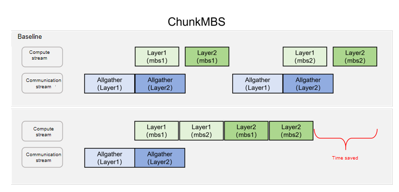

# ChunkMBS

## Applicable Backends

FSDP2

## Background and Challenges

When large models are trained with FSDP2, the complete parameter unsharding process (including asynchronous copy-in, asynchronous communication, and synchronous copy-out) must be completed before each block computation. With extremely large parameter scales, communication overhead becomes excessive, so computation cannot fully overlap the communication latency, and the synchronous copy-out overhead accounts for a disproportionately large share, directly dragging down training throughput. At the same time, contention between communication and computation for bus bandwidth also reduces parallel computation efficiency.

Traditional optimization methods mainly increase the computation density after a single unsharding operation by increasing the sequence length or the Micro-Batch Size (MBS). However, this significantly increases device memory pressure. For large-parameter models, the static device memory is already substantial, leaving very limited room to increase the sequence length and MBS, which makes it difficult to effectively improve overall throughput through this path.

## Solution

This solution builds on two fundamental features: recomputation and async activation offload. During the forward computation phase, the system retains only the activations at the layer entry points and dynamically offloads them to host-side memory through an asynchronous mechanism. Under this mechanism, the device-side memory usage consists primarily of two parts:

- **Static memory**: the base memory occupied by model parameters, gradients, and optimizer states after sharding.
- **Dynamic memory**: the full activation memory required by a single block for a single micro-batch during the backward recomputation phase.

**Core optimization approach**: To break through the memory bottleneck, this approach introduces a fine-grained chunking mechanism along the batch dimension after a single parameter unsharding operation is completed. The implementation flow is as follows:

- **Chunking and computation**: The input of the current layer is split along the batch dimension into multiple micro-chunks, and the forward computation of each micro-chunk is completed in sequence. The backward pass proceeds chunk by chunk in the reverse order of the computation graph, and with recomputation enabled, the forward pass is recomputed chunk by chunk during the backward pass.
- **Asynchronous pipelining**: During forward computation gaps, the system asynchronously offloads (D2H) activation values. During the backward computation phase, the activations of the corresponding micro-chunk are migrated back (H2D) from host to device on demand; after the backward computation of that micro-chunk is complete, the next micro-chunk is processed.
- **Memory and throughput benefits**: With this strategy, the peak device memory footprint of activations is strictly compressed to the scale of a single micro-chunk. This effectively decouples the strong binding between memory footprint and computation scale, so that under limited device memory resources, larger computation scales can be accommodated by flexibly increasing the number of chunks, thereby maximizing overall training throughput.

A schematic diagram of this approach is shown below.



With the same GBS, setting `micro_batch_size` to MBS and the number of gradient accumulation steps (`gradient_accumulation_steps`) to `GBS/(DP*MBS)` requires unsharding each block's parameters in every gradient accumulation step; however, with this feature enabled, a typical usage is to set `micro_batch_size` to `GBS/DP` (that is, GBS when DP=1), set gradient accumulation to 1, and set `chunkmbs_plan.chunk_mbs` to the original MBS (that is, the size of each micro-batch before merging), so that each model parameter update only requires one parameter unsharding per block, greatly reducing communication time. On the Qwen3.5 35B model, the measured end-to-end performance gain is approximately 5%.

## How to Use

This solution must be used in combination with [async activation offload](../memory/async_activation_offload.md) and the recomputation feature: modules with ChunkMBS enabled must also have activation offload and recompute enabled (see "Notes" for the constraints). The enabling method is as follows:

```yaml
features:
  # Recomputation configuration
  recompute: true
  recompute_plan:
    apply_modules:
      - model.visual.blocks.{*}
      - model.language_model.layers.{*}

  # Activation offload configuration
  enable_activation_offload: true
  activation_offload_plan:
    apply_modules:
      - model.visual.blocks.{*}
      - model.language_model.layers.{*}

  # ChunkMBS configuration
  enable_chunk_mbs: true
  chunkmbs_plan:
    apply_modules:
      - model.language_model.layers.{*}
    chunk_mbs: 2 # This indicates the micro batch size after chunking.
    batch_dim: 0
    chunk_arg_indexs: [0]
    chunk_kwarg_names: ["position_embeddings", "position_ids", "rope_deltas", "attention_mask"]
```

### Parameter Description

| Configuration Item | Type | Default Value | Description |
| --- | --- | --- | --- |
| `enable_chunk_mbs` | bool | `false` | Whether to enable the ChunkMBS feature |
| `apply_modules` | list | `None` | The modules for which this feature is enabled, matched using regular expressions. Note that they must be included in the `apply_modules` of both the `recompute` feature and the `activation_offload` feature |
| `chunk_mbs` | int | `1` | The MBS after chunking. For example, if the original `micro_batch_size` is 8 and it is split into 4 parts, each part has a size of 2, then this field is configured as 2 |
| `batch_dim` | int | `0` | The dimension along which the batch size resides. For example, if the input layout of this layer is [b, s, h], then `batch_dim` is set to 0; if the input layout of this layer is [s, b, h], then `batch_dim` is set to 1 |
| `chunk_arg_indexs` | list | `[0]` | Indices of input arguments passed as positional arguments (args) that need to be chunked along the batch dimension |
| `chunk_kwarg_names` | list | `[]` | Names of input arguments passed as keyword arguments (kwargs) that need to be chunked along the batch dimension |

`chunk_arg_indexs` and `chunk_kwarg_names` indicate which input arguments need to be chunked. Take the following input as an example:

```python
hidden_states = decoder_layer(
    hidden_states,
    position_embeddings=position_embeddings,
    attention_mask=layer_mask,
    position_ids=text_position_ids,
    past_key_values=past_key_values,
    use_cache=use_cache,
    cache_position=cache_position,
    **kwargs,
)
```

Among them, `hidden_states`, `position_embeddings`, `attention_mask`, `position_ids`, and `rope_deltas` need to be chunked along the `batch_size` dimension, while the remaining input arguments do not need to be chunked. `hidden_states` is passed in the form of `args`, while `position_embeddings`, `attention_mask`, `position_ids`, and `rope_deltas` are passed in the form of `kwargs`, so the configuration is set as described above.

### Example Script

See `examples/qwen3_5/finetune_qwen3_5_27B.sh` (for the configuration fields, see the `features` section of `examples/qwen3_5/qwen3_5_27B_config.yaml`; in the repository example, `enable_chunk_mbs` defaults to `false`, and must be set to `true` and used together with recompute and activation offload).

## Notes

### Known Constraints

- The framework does not verify the relationship between ChunkMBS and the enabling of recompute/activation offload; if they are not enabled together, the activations of each micro-chunk will all reside in device memory before the backward pass, and the memory gain will be lost.
