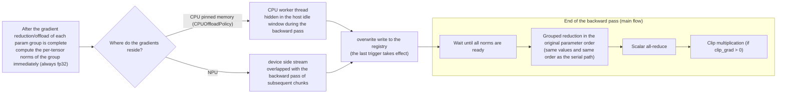

# Grad Norm Overlap (Gradient Norm Masking)

## Applicable Backends

FSDP2

## Background and Challenges

In FSDP2 training, the local norm summation before gradient clipping is executed serially after the backward pass ends: all gradients are read at once to compute per-tensor norms and sum them. In the `CPUOffloadPolicy` scenario (gradients are offloaded to the CPU), the norm computation is forced to use the CPU memory bandwidth (about 40 times lower than NPU HBM), so this serial host overhead is particularly significant. In addition, with `reduce_dtype: bf16`, the old summation implementation materializes all gradients into fp32 first, which causes a transient device memory spike of about twice the gradient size.

## Solution

The norm computation is executed in chunks by FSDP2 param group and pipelined with the backward pass, so that it is overlapped into the backward window. When the feature is enabled, each param group computes its per-tensor gradient norms immediately after its gradient reduction/offload is complete, overlapping with the backward pass of subsequent chunks; when the backward pass ends, only one grouped reduction in the original order, one scalar all-reduce, and the clip multiplication remain.

### Solution Principle

The execution path is selected automatically according to where the gradients reside. Both paths share the same norm registry (written by parameter in an overwrite manner, and the last trigger takes effect):



In terms of timing, the norm computation is overlapped into the backward window, and only a lightweight tail section remains when the backward pass ends:

```mermaid
sequenceDiagram
    autonumber
    participant CS as Compute stream (backward)
    participant NS as Norm executor (side stream/CPU worker)
    participant HOST as Main flow

    loop For each param group
        CS->>NS: The gradient reduction/offload of group i is complete; trigger the norm computation immediately
        NS->>NS: Per-tensor norms of group i → overwrite the registry
        Note over CS: The backward pass of subsequent chunks continues, and the norm computation is overlapped
    end
    CS->>HOST: The backward pass ends
    HOST->>NS: Wait until all norms are ready
    HOST->>HOST: Grouped reduction in the original order → scalar all-reduce → clip multiplication
```

Key points:

- **Only per-tensor norms are computed, and no summation is performed within a group**: the summation is left to the main flow in the original parameter order, with the same values, the same order, and the same kernel as the serial path, which structurally guarantees bitwise consistency for uniform dtype configurations.
- **Overwrite semantics (the last trigger takes effect)**: when gradient accumulation or module reuse (such as MTP sharing `embed_tokens`/`lm_head`) causes the same group to be triggered multiple times, only the result of the last trigger is consumed.
- **The overlap ratio depends on the backward window**: tail groups (such as the `embed_tokens`/root group) are triggered as a fallback only after the backward pass ends, so their norms cannot be overlapped; the longer the backward window of a model, the more thorough the overlap.

An incidental optimization (also effective when the switch is disabled): the local norm summation implementation is rewritten in a batched manner, and non-FP32 gradients are computed directly in FP32 precision, which eliminates the bf16 materialization spike (bitwise consistent with the materialization path). When gradient dtypes are mixed on the same device, all gradients are still materialized into FP32, bitwise consistent with the existing behavior.

Precision and correctness guarantees:

- With a uniform dtype configuration, the total norm is **bitwise identical** to the current path (same data, same kernel, same summation order), and the loss is bitwise identical over the full sequence (verified by off/on comparisons of multiple groups).
- The overwrite semantics (the last trigger overwrites) guarantee correctness in gradient accumulation and module reuse scenarios (such as MTP sharing `embed_tokens`/`lm_head`).
- In scenarios that do not meet the preconditions, the feature **safely falls back to the current path** and prints a warning (once; except for the scenarios marked as "silent fallback" in "Known Constraints"), instead of silently diverging.
- No new device memory spike is introduced; in non-offload scenarios there is a static memory footprint of about +2 MB (the norm scalars of the side stream reside there).

## Use Cases

- **Recommended**: FSDP2 + `CPUOffloadPolicy` (gradients are offloaded to the CPU), especially for large models with a long backward window, where the serial norm section is overlapped most thoroughly.
- **Optional**: the `clip_grad: 0.0` scenario (norms are only recorded but not clipped), where there is no clip multiplication pass and the overlap ratio is the largest.
- **Limited gain**: in non-offload scenarios, the serial section itself accounts for a small proportion of the step time (about 0.3% measured), so the step-level gain is usually not measurable.
- **Unnecessary**: `fully_shard_parallel_size == 1` (DDP path) has no FSDP groups, so this feature has no target.

## How to Use

Enable it in the `features` section of the model YAML configuration file:

```yaml
features:
  enable_grad_norm_overlap: true
```

No other configuration is required. After it is enabled, the execution path is selected automatically according to the gradient location; if the preconditions are not met, the feature automatically falls back to the current path and prints a warning (for silent fallback scenarios, see "Known Constraints").

### Parameter Description

| Parameter | Type | Default | Description |
| --- | --- | --- | --- |
| `enable_grad_norm_overlap` | bool | `false` | Whether to enable Grad Norm Overlap; it also takes effect when `clip_grad: 0.0` (only the norm computation is overlapped); the execution path is selected automatically depending on whether offload is used |

### Example Script

See `examples/qwen3_5/finetune_qwen3_5_4B.sh` (to enable it, add `enable_grad_norm_overlap: true` to the `features` section of its YAML configuration).

## Results

| Model | Hardware | Cluster Scale | Before | After | Gain |
| --- | --- | --- | --- | --- | --- |
| Qwen3.5-4B + CPUOffloadPolicy | Ascend 910 | 1x4 | Serial section 209ms | 63ms | -70% |
| Qwen3.5-35B-A3B + CPUOffloadPolicy | Ascend 910 | 1x4 | Serial section 1024ms | 3.3ms | -99.7% (step level +1.06s/step ≈ +5.9%) |
| Qwen3.5-35B-A3B + EP=2 | Ascend 910 | 1x4 | Serial section 747ms | 1.0ms | -99.9% |
| Qwen3.5-4B non-offload | Ascend 910 | 1x4 | Serial section 13.1ms | 3.9ms | -70% (only about 0.3% of the step, not measurable at the step level) |

> Measured environment: Ascend 910 (4 devices)/CANN 9.0.0 / torch 2.7.1 + torch_npu 2.7.1, timing with segmented instrumentation over 10 iterations, data as of 2026-08. The step-level gain of 35B was confirmed by a paired A/B test in the same window (3 consecutive pairs run with OFF/ON alternating).

Precision verification (as of 2026-08): in 7 off/on comparisons (4B offload with clip=0/clip=1.0/gradient accumulation GA=2, 4B non-offload with clip=0/clip=1.0, 35B offload, and 35B EP=2), the loss and the total norm are bitwise identical over the full sequence; max reserved does not increase (byte-identical for 35B; the +2 MB static footprint in non-offload scenarios is described above). After the instrumentation was stripped, the final code form was rechecked by 4B offload off/on smoke comparisons: under torch 2.7.1 and torch 2.10.0 (torch_npu 2.10.0.post4), the loss and the total norm are bitwise identical over the full sequence.

## Notes

### Known Constraints

**Fallback matrix** (the behavior is selected by scenario when the switch is enabled):

| Scenario | Behavior |
| --- | --- |
| `CPUOffloadPolicy` (gradients are offloaded to the CPU) | CPU worker path |
| Gradients on the NPU + patched post_backward present (currently torch 2.7.1/2.9.0/2.10.0) | device side stream path |
| Gradient dtypes mixed on the same device | Fall back to the current path + warning (once) |
| `norm_type != 2` | Disable this feature + warning (once) (the training pipeline in the repository always uses the 2-norm, and there is no such configuration key) |
| The torch version has no patched post_backward (other than the three versions above) | Remain disabled at startup + warning |
| torch.compile | Not specifically verified: by default only the forward pass is compiled, the backward pass remains eager, and the mechanism still takes effect; compiled autograd is not adapted or verified |
| `fully_shard_parallel_size == 1` (DDP path) | No FSDP group is triggered, so the feature silently falls back to the current path (no warning) |

Other constraints:

- Verified scope: Qwen3.5-4B/Qwen3.5-35B-A3B, offload and non-offload, gradient accumulation GA=2, and EP=2 (data as of 2026-08). Scenarios beyond the verified scope are not guaranteed.
- The reduction of `embed_tokens` (no gradient for its input) and of the root group is triggered as a fallback by the root callback after the backward pass ends, so their norms fall in the tail; for large models with a long backward window the measured impact is negligible, and for models with a short window the overlap ratio should be evaluated case by case.
- In offload scenarios, the overlap ratio is affected by the pinned memory read bandwidth and the host utilization during the backward pass. It is recommended to perform A/B verification with the actual configuration.

### Stackable Features

- Gradient accumulation: the overwrite semantics guarantee correctness, and GA=2 has been verified.
- Expert parallelism (EP): the non_ep and ep reduction groups each take their own norms, and EP=2 has been verified.
- `clip_grad: 0.0` (norms are only recorded): also effective, with the largest overlap ratio.
