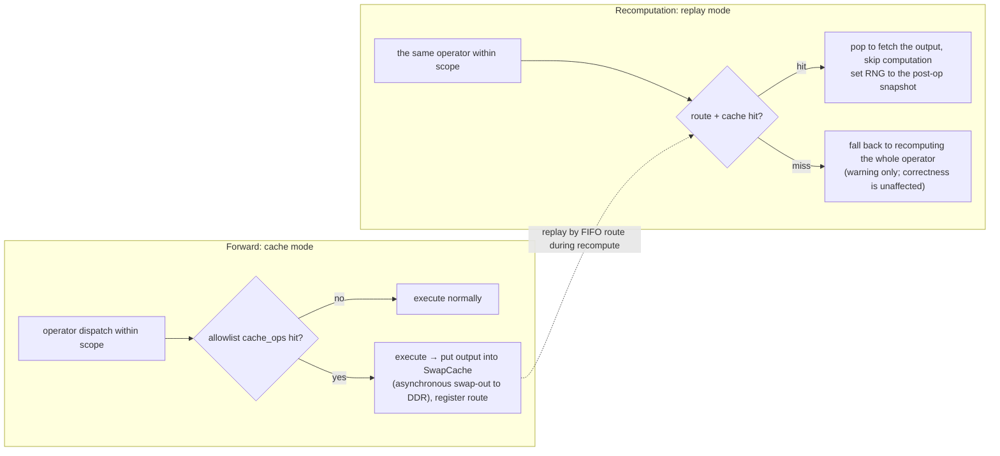

# Op Replay (Operator Replay)

> Op Replay is a tenant on top of the [Swap Core](../memory/swap_core.md) foundation, and its only interactions with the foundation are the two interfaces `put`/`pop`. The physical behavior of swapping in and out is determined by the shared `swap_plan` configuration. For the behavior and conventions of the foundation, see [Swap Core](../memory/swap_core.md). This document describes only the configuration and semantics of Op Replay itself.

## Applicable Backends

FSDP2

## Background and Challenges

Full recomputation (checkpoint) discards forward activations and recomputes them during the backward pass, trading a large amount of redundant computation for memory. The recomputation overhead of expensive operators such as matmul and attention is particularly significant. Existing per-operator skip mechanisms (skip FA / skip GDN) can eliminate the recomputation of key operators, but they require intrusive integration operator by operator, so every new operator needs another implementation, which makes evolution costly.

## Solution

Op Replay introduces a scope inside checkpoint: by defining the module range and the operator allowlist through configuration alone, users can make the outputs of allowlisted operators within the scope swapped out during the forward pass and fetched back directly during recomputation, skipping recomputation. Only the outputs of a small number of expensive operators are cached, using a controllable HBM budget + DDR bandwidth to eliminate most of the recomputation overhead. To this end, the operator outputs that must survive from the forward pass to recomputation are managed uniformly by the Swap Core foundation.

### Implementation Principle



Key points for reading the diagram:

- **Bit-exact RNG alignment**: the invariant is "the RNG stream position of recompute ≡ the same position in forward". The checkpoint-level `fork_rng` handles entry alignment, and Op Replay fills only one gap—a replayed (skipped) operator consumes 0 RNG, so during replay the RNG stream is moved to the post-op snapshot of that operator's forward pass. Operators that still need recomputation afterwards (including miss fallback) continue consuming from that position, consistent with forward.

## Use Cases

- **When to enable**: recomputation is already enabled and the recomputation overhead of expensive operators such as matmul/attention accounts for a significant share of step time. Use a controllable on-chip memory budget + DDR bandwidth to eliminate this part of the recomputation.
- **When not to enable**: when recomputation is not enabled there is no mount point (Op Replay is activated only inside checkpoint). When the scope falls outside the coverage of `recompute_plan.apply_modules`, replay never happens (no error is reported, it simply does not take effect). When all operators in the scope are cheap, the swap-out/fetch bandwidth overhead exceeds the recomputation saved, so there is no gain.

## How to Use

It takes effect only when all of the following are satisfied: `features.recompute: true`; `use_reentrant: false` (under reentrant, checkpoint does not use `context_fn`, so Op Replay is never activated and is skipped with a warning at startup); `op_replay_scopes` is non-empty (non-empty means enabled).

Minimal configuration example:

```yaml
features:
  recompute: true
  recompute_plan:
    apply_modules:
      - model.language_model.layers.{*}
    use_reentrant: false
    op_replay_scopes:
      - name: layer_attn
        apply_modules:
          - model.language_model.layers.{*}.self_attn
        # cache_ops falls back to the built-in allowlist by default (matmul family + SDPA flash attention)
  swap_plan:
    capacity_mb: 1024   # budget shared by multiple tenants; when enabled together with Act Stash, plan by total amount
```

### Parameter Description

**recompute-related fields**

| Configuration Item | Type | Default Value | Meaning and Value Constraints |
| --- | --- | --- | --- |
| `features.recompute` | bool | false | Master switch for recomputation (gradient checkpointing). Treated as false when not configured. Note that this field is a pass-through configuration item without type checking, and is evaluated by truthiness—write an unquoted boolean in YAML (`recompute: true`, not `recompute: "true"`). |
| `recompute_plan.apply_modules` | List[str] | [] | Modules to which recomputation is applied (module names are matched against the pattern, with `{*}` wildcard support, such as `model.language_model.layers.{*}`). |
| `recompute_plan.use_reentrant` | bool | false | Whether to use reentrant checkpoint. **Op Replay takes effect only when this is `false`**: under reentrant, checkpoint does not use `context_fn`, so Op Replay is never activated (it is skipped with a warning at startup). |
| `recompute_plan.op_replay_scopes` | List[scope] | [] | List of Op Replay scopes; **a non-empty value enables** Op Replay. Each scope is an independent configuration of "region × allowlist × RNG policy". |

**scope fields**

| Configuration Item | Type | Default Value | Meaning and Value Constraints |
| --- | --- | --- | --- |
| `op_replay_scopes[i].name` | string/null | None | Scope label, used for logging only. |
| `op_replay_scopes[i].apply_modules` | List[str] | [] | Modules that define the scope region. **Must fall within the coverage of `recompute_plan.apply_modules`**—dispatch mode is activated only inside checkpoint, so a scope outside that coverage never replays (no error is reported, it simply does not take effect). |
| `op_replay_scopes[i].save_rng` | bool | true | Whether to record/replay the RNG snapshot after execution of cached operators within this scope. When the scope contains random operators (such as dropout, randn_like, and so on), this keeps the recomputation RNG stream aligned operator by operator with forward, ensuring consistent gradients; it can be disabled when the scope contains no random operators. |
| `op_replay_scopes[i].cache_ops` | List[str]/null | None | allowlist of cached operators, whose elements are fully qualified `torch.ops` names (such as `aten.mm.default`, `npu.npu_fusion_attention.default`). `None` falls back to the built-in default allowlist: the matmul family (`aten.mm.default`/`aten.addmm.default`/`aten.bmm.default`/`aten.linear.default`) and `aten._scaled_dot_product_flash_attention.default`; **an explicit empty list = cache no operators**. Caching is always gated by the allowlist, and there is no "cache everything" mode. |

### Registering Custom Operators

Cache decisions are gated by fully qualified `torch.ops` names, so a custom operator must be registered as a `torch.ops`-addressable op before it can enter the allowlist; bare Python functions and `autograd.Function` cannot be matched. Registration method:

```python
from torch.library import custom_op

@custom_op("mylib::my_op", mutates_args=())
def my_op(x: torch.Tensor, ...) -> torch.Tensor:
    ...
```

Write the three-part fully qualified name `mylib.my_op.default` in the allowlist, that is, "namespace.operator name.overload". Registration requirements:

- **`mutates_args=()` must be empty**: operators that declare argument mutation (mutable schema) are rejected for caching by the entry check, which prints a one-time warning. Operators that declare an empty list but do perform in-place writes internally cannot be detected, so you must ensure yourself that the output is not reused in place before it is fetched back; see "Known Constraints".
- **Return values must not alias inputs**: returns with view semantics (aliasing declared in the schema) are likewise rejected for caching; when a tuple is returned, each tensor is cached and fetched back independently.
- **Internal use of random numbers requires no special handling**: execution is skipped during replay, and the RNG stream is aligned through the post-op snapshot of `save_rng`.
- **Registration must precede wiring**: wiring happens after model construction completes, and importing the operator module during model construction performs registration. The allowlist is parsed strictly, and startup fails immediately when an op name cannot be parsed—typos, or the case where the model implementation branch does not actually use that operator, are exposed here.

## Notes

### Known Constraints

- **Operators intercepted by the entry check do not enter the cache**: operators with in-place (mutable schema) and view (returning an alias of the input) semantics are rejected based on schema checks (they should be removed from `cache_ops`); operators with storage changes, metadata operations, or inconsistent call order (`detach`/`set_`/`resize_`/`prim.device`, and so on) are excluded by op name through the built-in blacklist `_OP_REPLAY_IGNORED_OPS`—a custom operator with an inconsistent call order makes FIFO routing match the wrong op and silently produce wrong values, so you must confirm that the call order is consistent between the two executions.
- **Swapped-out operator outputs must not be overwritten in place**: the cached output must not be touched by any in-place write between put and fetch-back (the contract has no runtime fallback; violating it silently produces incorrect gradients). For the contract, see the usage conventions in [Swap Core](../memory/swap_core.md). A common safe pattern: residual in-place operations land on non-cached tensors (`hidden.add_(attn_out)`); dangerous patterns: directly overwriting the cached output (`out = mm(a, b); out.add_(bias)`), and reusing a shared workspace across layers (the entry check cannot stop this when the custom operator schema does not declare an alias). Remedies: switch to a functional form (`out = mm(a, b) + bias`), remove the operator from `cache_ops`, or narrow the scope to bypass such modules.
- **Mutually exclusive with nested recomputation**: when Op Replay is enabled, if `recompute_plan.apply_modules` matches both a module and its descendant modules (nested checkpoint), an error is raised directly during wiring; remove the overlapping match patterns. Ordinary nested recomputation that does not enable Op Replay is not affected.
- **Scope priority**: when multiple scopes match the same module, the one earlier in the list takes effect (list order = priority); for nested scopes (the region of one scope falls inside another), the inner scope takes priority.
- **`kwargs` independence**: cache decisions occur at the operator dispatch layer and are gated by `torch.ops` name, independent of the specific form in which arguments are passed to the operator (`args`/`kwargs`).
