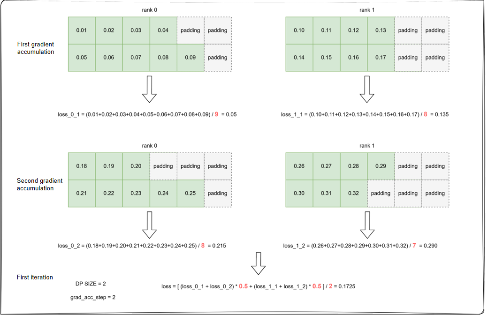
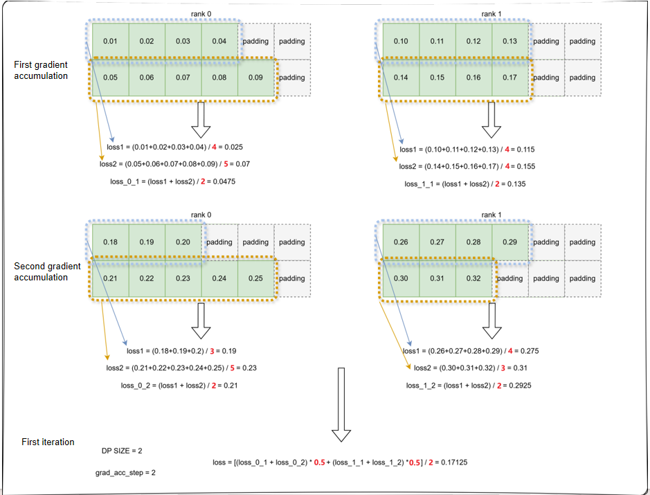
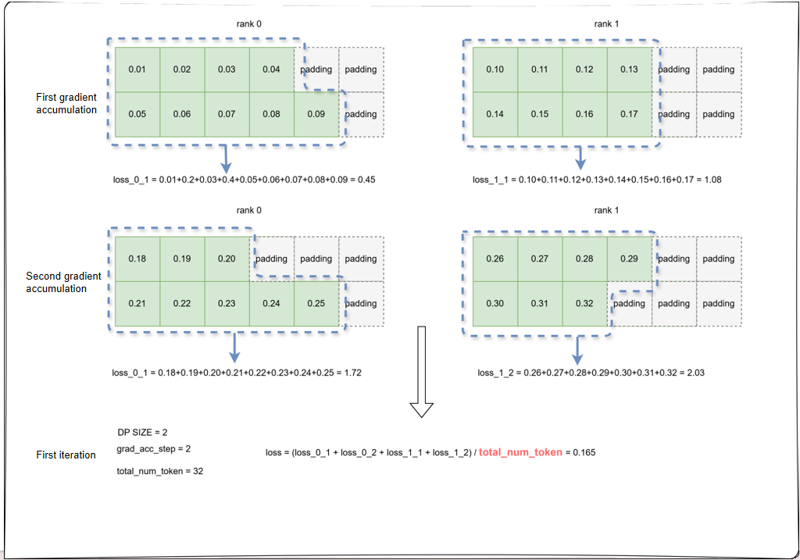

# Loss Calculation Types for VLM Models

## Applicable Backends

FSDP2 + Mcore

## Problem Analysis

Vision-Language Models (VLMs) usually use the cross-entropy loss as the training objective. However, **the implementations in current mainstream model repositories (such as Hugging Face Transformers) have a problem: when the global batch size is fixed, different combinations of the micro-batch size (micro_batch_size) and the number of gradient accumulation steps (grad_acc_steps) (for example, `micro_batch_size=32, grad_acc_steps=2` vs `micro_batch_size=16, grad_acc_steps=4`) cause considerable differences in the loss curve and the final values during model convergence under the same hyperparameters and training data**. For related discussions, see [gradient](https://unsloth.ai/blog/gradient).

> Note: Transformers has fixed this issue in some models, but in models such as Qwen2.5-VL and Qwen3-VL, the issue still exists because the related code passes parameters incorrectly or explicitly does not calculate `num_token_in_batch`.

## Solution

For VLM models, MindSpeed MM provides three loss calculation methods. Assume that the training configuration is `micro_batch_size=2` and `grad_acc_steps=2` and that two devices are used (that is, DP=2). The steps of the three loss calculation methods are as follows:

### Default Method

Consistent with the Transformers implementation, the calculation process is as follows:

- **Step 1**: Average the cross-entropy loss of valid tokens over the micro-batch dimension.
- **Step 2**: Average over the gradient accumulation dimension.
- **Step 3**: Average over the data parallelism (DP) domain.



### Calculating Loss Per Sample (Calculate Per Sample Loss)

The calculation process is as follows:

- **Step 1**: Average the cross-entropy loss of valid tokens within each sample.
- **Step 2**: Average over the micro-batch dimension.
- **Step 3**: Average over the gradient accumulation dimension.
- **Step 4**: Average over the data parallelism (DP) domain.



### Calculating Loss Per Token (Calculate Per Token Loss)

The calculation process is as follows:

- Directly accumulate the cross-entropy loss of all valid tokens in the global batch.
- Divide the final result by the total number of valid tokens in the global batch.



## How to Use

### Megatron Backend

For models using `pretrain_vlm.py` as the entry point, enable loss calculation as follows:

#### Default Calculation Method

In the model training script, **do not enable** any of the following parameters:

- `--calculate-per-sample-loss` calculates the loss per sample.
- `--calculate-per-token-loss` calculates the loss per token.

#### Calculating Loss Per Sample

Enable the following parameter in the model training script:

```shell
GPT_ARGS="
    ...
    --calculate-per-sample-loss \
"
```

#### Calculating Loss Per Token

Enable the following parameter in the model training script:

```shell
GPT_ARGS="
    ...
    --calculate-per-token-loss \
"
```

### FSDP2 Backend

The FSDP2 backend sets the loss calculation type through the `loss_type` field of `loss_cfg`. The two configuration methods support different value ranges, as described below.

#### Native FSDP2 (Recommended)

Set the field in the `features.loss_cfg` section of the model YAML configuration file:

```yaml
features:
  loss_cfg:
    loss_type: default   # Options: raw (default) / default / per_sample_loss / per_token_loss
```

| Value | Description |
| --- | --- |
| `raw` (default) | Directly use the `.loss` of the raw model output without additional loss aggregation |
| `default` | Default calculation method |
| `per_sample_loss` | Calculate the loss per sample |
| `per_token_loss` | Calculate the loss per token |

#### Megatron-based FSDP2 (Transitional, to Be Deprecated)

For models whose training entry is `pretrain_transformers.py`, add the following fields to `model.json`:

```json
"loss_cfg": {
    "loss_type": "default"
}
```

| Value | Description |
| --- | --- |
| `default` (default) | Default calculation method |
| `per_sample_loss` | Calculate the loss per sample |
| `per_token_loss` | Calculate the loss per token |
| `token_loss` | Calculate the loss per token (normalized by the global average number of tokens) |
| `square_loss` | Weighted by the reciprocal of the square root of the number of valid tokens in each sample |

`raw` is not supported.

### Example Script

See `examples/qwen3_5/finetune_qwen3_5_4B.sh` (for the configuration, see the `features.loss_cfg` section of `examples/qwen3_5/qwen3_5_4B_config.yaml`; `loss_type` can be changed to `per_sample_loss`/`per_token_loss` as required).

## Notes

### Known Constraints

1. If the Megatron backend is used, the `--calculate-per-sample-loss` and `--calculate-per-token-loss` parameters cannot be used at the same time (the framework performs a conflict check and reports an error when both are enabled).
2. An inappropriate choice of loss calculation method greatly affects the evaluation of downstream tasks. Users need to select an appropriate calculation method based on the actual sample distribution of the dataset. If the training dataset has an uneven sample distribution, where some samples have very long responses, some have very short responses, or even a single token, calculating the loss per token gives more weight to samples with a larger number of target tokens, which introduces imbalance among samples and makes long outputs trained more thoroughly.
3. Both FSDP2 paths (native/Megatron-FSDP2) require `PrefetchGradAccDataLoader` for `per_token_loss`; otherwise, a `KeyError` is thrown at runtime (verified against the explicit raise in `mindspeed_mm/fsdp/loss/loss_func.py` and `mindspeed_mm/models/transformers_model.py`).
