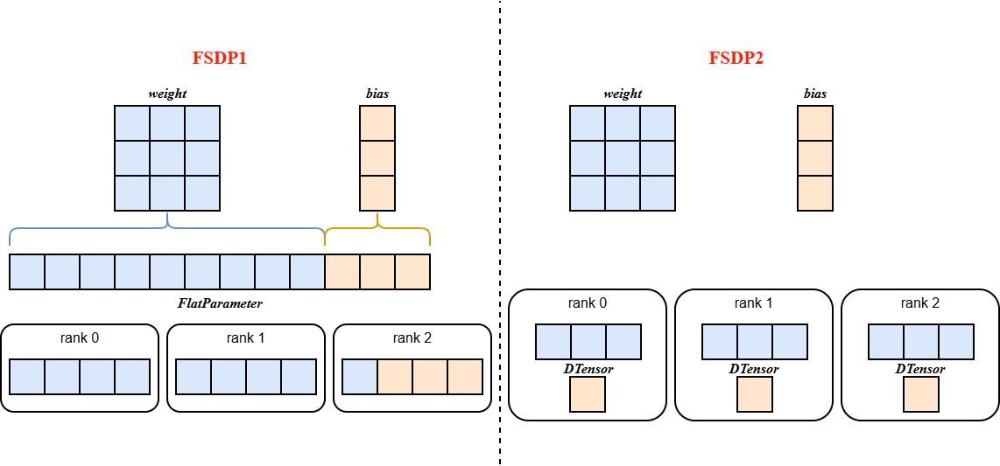

# FSDP2

Last updated: 12/08/2025. Author: zs-derrick

## Background and Challenges

PyTorch Fully Sharded Data Parallel (FSDP) aims to provide a high-performance eager-mode implementation, including communication bucketing and communication/computation overlap. This API represents communication buckets by flattening and concatenating a group of parameters into a FlatParameter. However, this FlatParameter design makes it difficult to perform differentiated operations on a single parameter within a bucket (such as parameter freezing and precision conversion), which harms composability and also complicates the internal implementation (for example, the state dict logic is thousands of lines long and requires extra communication).

## Solution

Based on the above limitations, FSDP2 removes FlatParameter and uses DTensors sharded along dimension 0 to represent sharded parameters, which supports convenient operations on individual parameters, sharded state dicts without communication, and a simpler initialization process. In addition, FSDP2 implements an improved memory management system that reduces and makes device memory usage deterministic by avoiding the use of recordStream, without any host synchronization.

<div align="center"></div>

## Core Mechanism

1. **Parameter sharding**: During model initialization, `fully_shard` shards `model.parameters()` from a regular `torch.Tensor` by rank and converts them to the `DTensor` format. These parameters are moved to the corresponding devices according to the device mesh.

2. **Parameter aggregation and re-sharding in the forward and backward passes**:

   - Parameter aggregation: The `pre_hook` of `forward/backward` aggregates all parameters and converts `model.parameters()` from `DTensor` back to a regular `torch.Tensor`.
   - Parameter re-sharding: After the computation of `forward/backward` is complete, `post_hook` releases the unsharded parameters (without communication) and converts the parameters back to `DTensor`.

3. **Bottom-up grouping strategy**: In complex models, `fully_shard` should be applied in a bottom-up order. For example, apply `fully_shard` to each TransformerLayer first and then to the root model.

<div align="center"></div>

## How to Use

### Model Inheritance Requirements

Models that need to be trained with FSDP2 must inherit specific Mixin classes:

```python
from mindspeed_mm.models.common.module import MultiModalModule
from mindspeed_mm.models.transformers.base_model import FSDP2Mixin, WeightInitMixin

class YourModel(MultiModalModule, FSDP2Mixin, WeightInitMixin):
    ...
```

### Launch Command Configuration

The following command line parameters must be configured when training with FSDP2:

```shell
export CUDA_DEVICE_MAX_CONNECTIONS=2

--use-torch-fsdp2 \
--fsdp2-config-path ./fsdp2_config.yaml \
--ckpt-format torch_dcp \
--untie-embeddings-and-output-weights \
```

Key parameters:

- `--use-torch-fsdp2`: Enables the FSDP2 training mode.
- `--fsdp2-config-path`: Specifies the path of the FSDP2 configuration file.

For the parameters in the FSDP2 configuration file, see [FSDP2 Parameter Description](../../reference/mcore-fsdp2_configuration.md)

### Meta Initialization for Large Models

For training models with an extremely large number of parameters, it is recommended to enable Meta initialization to avoid issues such as memory usage and slow loading:

```shell
--init-model-with-meta-device
--no-initialization
```

### User-defined Sharding Policy (Optional)

For scenarios with a complex model structure or where YAML configuration is inconvenient, users can customize the sharding policy through the API provided by FSDP2Mixin. In this case, only the `basic configuration` needs to be provided in the YAML file:

**Example of customizing fully_shard**

```python
from mindspeed_mm.models.common.module import MultiModalModule
from mindspeed_mm.models.transformers.base_model import FSDP2Mixin, WeightInitMixin

class YourModel(MultiModalModule, FSDP2Mixin, WeightInitMixin):
    def _fully_shard(self, fsdp2_kwargs=None, fsdp2_config=None):
        """
        Customized fully_shard implementation
        """

        # Customized recomputation modules (optional)
        set_recompute_modules_to_wrap()

        # Customized fully_shard wrapping modules
        set_fullyshard_modules_to_wrap()

        # Customized prefetch policy (optional)
        num_to_forward_prefetch = getattr(self.fsdp2_config, "num_to_forward_prefetch", 0)
        num_to_backward_prefetch = getattr(self.fsdp2_config, "num_to_backward_prefetch", 0)
        set_modules_to_prefetch(num_to_forward_prefetch, num_to_backward_prefetch)
```

For more details, see the `FSDP2Mixin` implementation.

## Results

For Llama-7B, FSDP2 achieves a higher MFU than FSDP1, reduces the peak memory by 7%, and maintains the same loss curve.

## Notes⚠️

1: When FSDP2 training is enabled, the distributed optimizer and its related configurations must be disabled.

2: When FSDP2 training is enabled, the checkpoint saving format `ckpt-format` of model weights supports only `torch_dist` or `torch_dcp`.

- When it is set to `torch_dist`, the model must inherit from `MegatronModule` or implement the `sharded_state_dict()` method by itself. In addition, the size of dimension 0 of all weights in the model must be greater than or equal to sharding_size.
- When it is set to `torch_dcp`, the model must inherit from `MegatronModule` or implement the `state_dict_for_save_checkpoint()` method by itself, and the weight dictionary it returns must be the same as the value returned by `model.state_dict()`.
