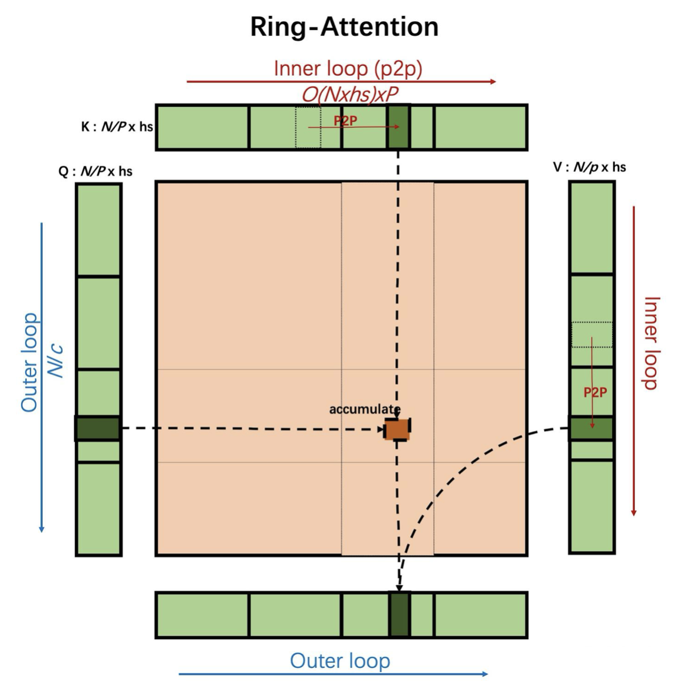

# RingAttention

**Ring Attention** draws on the computational idea of block-wise Softmax, so that block-wise self-attention computation can be performed without obtaining the global matrix of the complete sequence. This method decomposes the computation of self-attention and the feed-forward network into multiple small blocks and distributes these blocks along the sequence dimension to multiple compute devices.

Specifically, Ring Attention builds a ring-shaped communication structure (Ring) among processes. Each process holds local Q, K, and V blocks, completes the local attention computation first, and then iteratively completes the entire attention computation by successively sending KV blocks backward and receiving them forward from adjacent processes around the ring. In this design, local attention computation and KV block communication can be pipelined, and ideally the communication overhead can be fully hidden by the computation.

In addition, because Ring Attention does not need to concatenate global data during the whole computation, the sequence length it supports can theoretically scale infinitely, providing an efficient and scalable parallel solution for ultra-long sequence modeling.

The main flow is as follows:

- Data partitioning: partition the data according to cp_size (3 in the example) so that each rank obtains the corresponding shard;
- Block-wise attention computation: compute the self-attention value of the blocked data (FA2 is used for the computation in the figure) to obtain the single-step data;
- KV data exchange: build a ring network structure among ranks, and each rank exchanges KV data with adjacent ranks;
- Single-step computation correction: after the attention computation, the intermediate output value L must be corrected to ensure a correct output;
- Final output computation: after all block-wise attention computations are completed, correct and merge the final result O.

## How to Use

<!DOCTYPE html>
<html lang="zh-CN">
<head>
    <meta charset="UTF-8">
    <meta name="viewport" content="width=device-width, initial-scale=1.0">
    <title>Long Sequence Parallelism Parameter Description</title>
    
</head>
<body>
    

        <table>
            <thead>
                <tr>
                    <th width="350">Configuration Parameter</th>
                    <th>Parameter Description</th>
                </tr>
            </thead>
            <tbody>
                <tr>
                    <td>
                        --context-parallel-size [int]
                    </td>
                    <td>
                        Required. Sets the long sequence parallelism size. The default is 1; configure it according to your needs.
                    </td>
                </tr>
                <tr>
                    <td>
                        --context-parallel-algo
                    </td>
                    <td>
                        Optional. Sets the long sequence parallelism algorithm. The default is ulysses_cp_algo  
                        ulysses_cp_algo: enables Ulysses long sequence parallelism, the default value. 
                        megatron_cp_algo: enables Ring Attention long sequence parallelism. 
                        hybrid_cp_algo: enables Hybrid long sequence parallelism.
                    </td>
                </tr>
                <tr>
                    <td>
                        --use-cp-send-recv-overlap
                    </td>
                    <td>
                        Optional. It is recommended to enable it; after enabling, the send receive overlap feature is supported  
                    </td>
                </tr>
                <tr>
                    <td>
                        --attention-mask-type [general/causal]
                    </td>
                    <td>
                        Optional. The default is causal mask computation; set it to general for full computation  
                    </td>
                </tr>
                <tr>
                    <td>
                        --megatron-cp-in-bnsd
                    </td>
                    <td>
                        Optional. When enabled, the bnsd-format Attention computation is used  
                    </td>
                </tr>
                <tr>
                    <td>
                        --cp-window-size [int]
                    </td>
                    <td>
                        Optional. Optional; the default value is 1, which means the original Ring Attention algorithm is used. When it is set to a value greater than 1, the Double Ring Attention algorithm is used to optimize the performance of the original Ring Attention. --cp-window-size is the inner window size of the double-layer Ring Attention in the algorithm, and you need to ensure that cp_size is divisible by this parameter  
                    </td>
                </tr>
            </tbody>
        </table>
    

</body>
</html>
