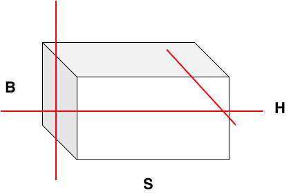

# sequence-parallel

Last updated: 12/04/2025. Author: cxiaolong

## Background and Challenges

In the fields of visual generation and understanding, video data often produces extremely long token sequences (typically over 32K) due to the large number of frames and high resolution, making long-sequence processing a core technical challenge for multimodal models. Traditional distributed training methods, namely data parallelism (DP), tensor parallelism (TP), and pipeline parallelism (PP), all partition data along different dimensions, as shown in the figure below, corresponding to the division of the batch size and the hidden layer dimension (hidden_size) respectively. However, for Transformer-based models, the computational complexity of attention grows quadratically with sequence length. When sequences are extremely long, the three parallelization methods above can neither utilize computing resources efficiently nor keep memory consumption under stable control.
Sequence Parallelism/Context Parallelism (SP/CP) is a parallelization technique that partitions long sequences along the sequence dimension across multiple computing devices.

<div align="center"></div>

## Solution

```{toctree}
:maxdepth: 2

ulysses
ringAttention
unified_SP
tp_sp
```
