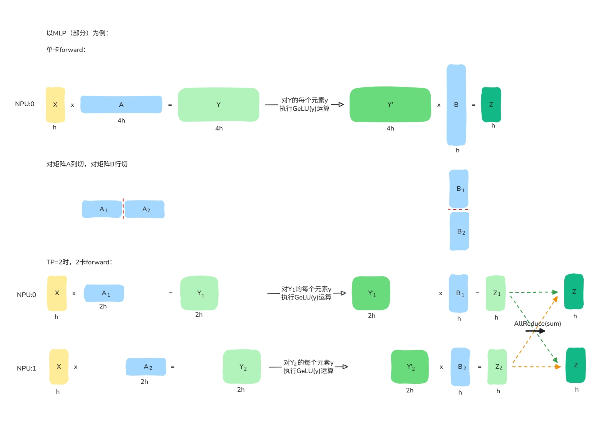

# tensor-parallel

Last updated: 12/13/2025. Author: yaoyaoxu

## Background and Challenges

To address the memory bottleneck in multimodal large model training, tensor parallelism (TP) shards the weight matrices within a layer across multiple computing devices to scale memory, making it a key model parallelism technique. It can be flexibly combined with strategies such as data parallelism and pipeline parallelism to form hybrid parallelism schemes that support training extremely large models.

<!--  -->

Note, however, that the essence of TP is trading communication for memory. As shown in the figure above, it introduces significant inter-device communication overhead. In scenarios where the model size or network bandwidth is insufficient to hide this overhead, enabling TP needs to be evaluated carefully.

## Core Design

**Paper Title**: Megatron-LM: Training Multi-Billion Parameter Language Models Using Model Parallelism

**Paper Link**: <https://arxiv.org/pdf/1909.08053>

TP is one of the model parallelism techniques proposed early in the Megatron-LM framework. It splits a single huge computation operation (especially matrix multiplication) across multiple computing devices for parallel execution, breaking through the memory and compute limits of a single device.

- **Intra-layer parallelism**: mainly targets compute- and memory-intensive matrix multiplication. A large weight matrix is partitioned by row or column, and each device stores and computes only one block of it.
- **Efficient communication pattern**: the carefully designed matrix partitioning makes the local computation volume far larger than the communication volume, minimizing the AllReduce communication overhead.

## How to Use

<!DOCTYPE html>
<html lang="zh-CN">
<head>
    <meta charset="UTF-8">
    <meta name="viewport" content="width=device-width, initial-scale=1.0">
    <title>TP Parameter Description</title>
    <style>
        body {
            font-family: Arial, sans-serif;
            padding: 20px;
            background-color: #fff;
        }
        .container {
            width: 100%;
            margin: 0 auto;
        }
        table {
            width: 100%;
            border-collapse: collapse;
            border: 1px solid #ddd;
        }
        th {
            background-color: #f2f2f2;
            padding: 12px 15px;
            text-align: left;
            border-right: 1px solid #ddd;
            border-bottom: 1px solid #ddd;
        }
        td {
            padding: 12px 15px;
            border-right: 1px solid #ddd;
            border-bottom: 1px solid #ddd;
        }
        tr:last-child td {
            border-bottom: none;
        }
        th:last-child, td:last-child {
            border-right: none;
        }
        .param-name {
            font-family: monospace;
            color: #c00;
            font-weight: bold;
        }
        .required {
            color: #c00;
            font-weight: bold;
        }
        .optional {
            color: #090;
            font-weight: bold;
        }
        .algorithm-name {
            font-family: monospace;
            color: #00c;
        }
        .default {
            color: #666;
            font-style: italic;
        }
    </style>
</head>
<body>
    <div class="container">
        <table>
            <thead>
                <tr>
                    <th width="350">Configuration Parameter</th>
                    <th>Parameter Description</th>
                </tr>
            </thead>
            <tbody>
                <tr>
                    <td>
                        <span class="param-name">--tensor-model-parallel-size [int]</span>
                    </td>
                    <td>
                        <span class="required">Required</span>. Sets the tensor parallelism size. The default value is 1; configure it according to your needs.
                    </td>
                </tr>
            </tbody>
        </table>
    </div>
</body>
</html>
<div style="height: 40px;"></div>

## Adapting TP from Scratch

TP requires intrusive modifications to the model definition. Taking xxmodel in the VLM as an example, the following adapts TP for the vision_encoder module (Transformer layer) in image_encoder:

### Code Adaptation

Specify `model_id` in `examples/xxmodel/model.json`:

```json
{
    "model_id": "xxmodel",
    "image_encoder": {
        "vision_encoder": {
            "model_id": "xxmodelvit",
            ...
        }
    }
}
```

`mindspeed_mm/models/common/module_spec/get_layer_spec.py` maps `model_id` to the reconstructed layer:

```python
from mindspeed_mm.models.common.module_spec.xxmodel_layer_spec import get_xxmodel_vit_layer_spec

# Register the model layer in the global mapping table
vit_layer_specs = {
    'xxmodelvit': get_xxmodel_vit_layer_spec,
    ...
}
```

`mindspeed_mm/models/common/module_spec/xxmodel_layer_spec.py` implements the model layer `get_xxmodel_vit_layer_spec`:

```python
def get_xxmodel_vit_layer_spec(config=None, is_vit=True, *args, **kwargs) -> ModuleSpec:
    return ModuleSpec(
        module=TransformerLayer,
        submodules=TransformerLayerSubmodules(
            self_attention=ModuleSpec(
                module=SelfAttention,
                submodules=SelfAttentionSubmodules(
                    linear_qkv=ColumnParallelLinear, # Use the class provided by core to column-shard qkv
                    core_attention=DotProductAttention, # Use the class provided by core to split attention heads
                    linear_proj=RowParallelLinear, # Use the class provided by core to row-shard proj
                ),
                ***other parts omitted
            ),
            mlp=_get_mlp_module_spec(use_te=False), # Use the interface provided by core to shard the MLP
            ***other parts omitted
        ),
    )
```

### Weight Sharding

Because TP changes the weight shape, the pretrained weights also need to be sharded. You can refer to the weight sharding methods used by models in the MM repository that already support TP. For VLM-related models, it is recommended to place the weight conversion scripts under `checkpoint/vlm_model/converters/`.

## Use Case and Results

- **Model**: Qwen2.5VL-7B
- **Hardware environment**: 910B2 (8 × Ascend A2 64 GB NPU)
- **Memory optimization results**:
    - TP=1 (baseline): memory usage per device 50.26 GB
    - TP=2: memory usage per device drops to 34.20 GB, saving 16.06 GB, about 32%
- **Compute throughput loss**:
    - TP=1 (baseline): throughput per device 11,042 Tokens/s
    - TP=2: throughput per device drops to 6,088 Tokens/s, a performance decrease of 44.86%
- **Conclusion**: when a single device can hold the complete model parameters and the intermediate training states, optimal throughput can be achieved, and enabling TP is not recommended. Therefore, the default TP value for this model is 1.
