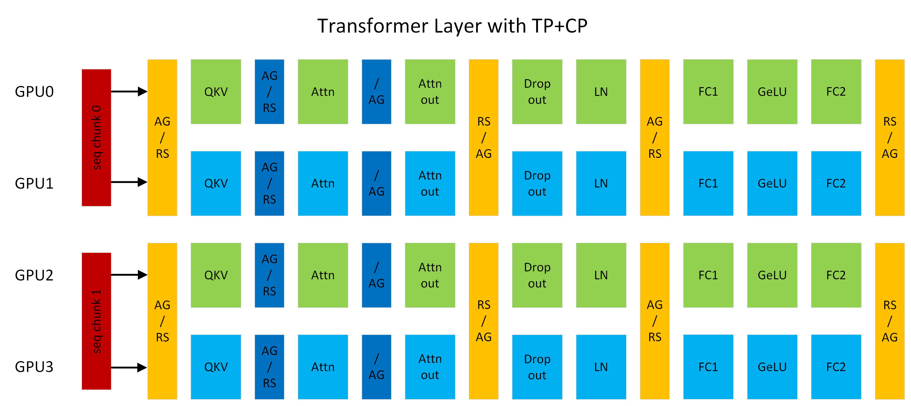

# TP-SP

TP-SP is a sequence parallelism technique first proposed by the Megatron-LM framework. Built on Megatron TP, it further shards the `Dropout` and `LayerNorm` modules of the Transformer model along the sequence dimension,

**Paper Link**: <https://arxiv.org/pdf/2205.05198>

Usage

## How to Use

<!DOCTYPE html>
<html lang="zh-CN">
<head>
    <meta charset="UTF-8">
    <meta name="viewport" content="width=device-width, initial-scale=1.0">
    <title>Long Sequence Parallelism Parameter Description</title>
</head>
<body>
    

        <table>
            <thead>
                <tr>
                    <th width="350">Configuration Parameter</th>
                    <th>Parameter Description</th>
                </tr>
            </thead>
            <tbody>
                <tr>
                    <td>
                        --tensor-model-parallel-size [int]
                    </td>
                    <td>
                        Required. Sets the TP parallelism degree. SP uses the same parallelism degree as TP.
                    </td>
                </tr>
                <tr>
                    <td>
                        --sequence-parallel
                    </td>
                    <td>
                        Required. Sets SP parallelism  
                    </td>
                </tr>
                <tr>
                    <td>
                        --use-ascend-mc2
                    </td>
                    <td>
                        Optional. In training scenarios where TP and SP are enabled, fuses the matmul and all_gather/reduce_scatter computation and communication operators to reduce memory overhead and improve computational efficiency  
                    </td>
                </tr>
            </tbody>
        </table>
    

</body>
</html>

> **Note**
>
> MoE models do not currently support enabling `--use-ascend-mc2`.
