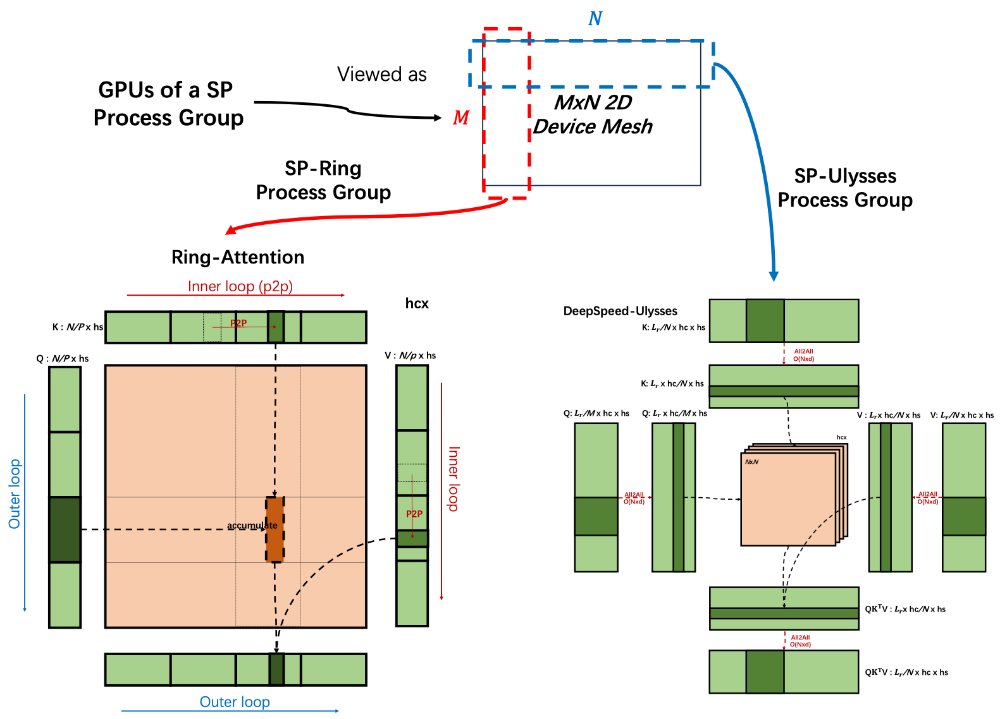
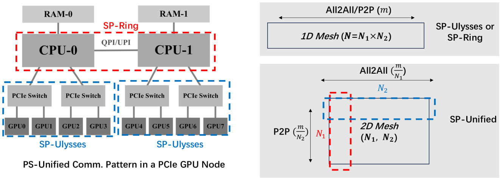

# USP (Hybrid Parallelism, Unified SP)

**Paper Title**: A Unified Sequence Parallelism Approach for Long-Context Generative AI

**Paper Link**: <https://arxiv.org/pdf/2405.07719.pdf>

**Project Repository**: <https://github.com/feifeibear/long-context-attention>

- Ulysses: When the sequence length and the number of compute devices increase proportionally, the communication volume remains constant. After the All2All operation, the partitioning of these four tensors moves from the sequence dimension L to the attention head dimension hc. In this way, the softmax(QK^T)V computation of each attention head can be performed completely without being interrupted by tensor partitioning.
- RingAttention: It can be regarded as a distributed version of FlashAttention. When each block of the output tensor O is computed, if the required K and V blocks are not available locally, they are obtained from other devices through point-to-point (P2P) communication. The communication of this method can be organized in a ring manner, where each device sends and receives K and V blocks at the same time, allowing communication to overlap with computation.

Ulysses maintains a constant communication volume when the number of compute devices and the sequence length increase, while Ring-Attention hides the point-to-point (P2P) communication cost introduced by SP through the overlap of computation and communication. However, the parallelism of DeepSpeed-Ulysses is limited by the number of attention heads, and Ring-Attention has low computational efficiency in blocked matrix multiplication.

To overcome these limitations, a unified sequence parallelism method is proposed that combines the techniques of DeepSpeed-Ulysses and Ring-Attention. Through a hybrid parallel strategy over the sequence dimension, this unified method allows DeepSpeed-Ulysses and Ring-Attention to run on different compute devices respectively, thereby optimizing the communication pattern and computational efficiency.

Specifically, the unified SP method runs in a process group of a 2D grid, where DeepSpeed-Ulysses operates along the rows of the grid and Ring-Attention operates along the columns. This setup not only improves the adaptability to model architectures and network hardware, but also improves the overall computational performance through more effective load balancing and communication patterns.

## How to Use

<!DOCTYPE html>
<html lang="zh-CN">
<head>
    <meta charset="UTF-8">
    <meta name="viewport" content="width=device-width, initial-scale=1.0">
    <title>Long Sequence Parallelism Parameter Description</title>
    
</head>
<body>
    

        <table>
            <thead>
                <tr>
                    <th width="350">Configuration Parameter</th>
                    <th>Parameter Description</th>
                </tr>
            </thead>
            <tbody>
                <tr>
                    <td>
                        --context-parallel-size [int]
                    </td>
                    <td>
                        Required. Sets the long sequence parallelism size. The default value is 1. Configure it based on user requirements.
                    </td>
                </tr>
                <tr>
                    <td>
                        --context-parallel-algo
                    </td>
                    <td>
                        Optional. Sets the long sequence parallelism algorithm. The default value is ulysses_cp_algo  
                        ulysses_cp_algo: Enables Ulysses long sequence parallelism, default value. 
                        megatron_cp_algo: Enables Ring Attention long sequence parallelism. 
                        hybrid_cp_algo: Enables Hybrid long sequence parallelism.
                    </td>
                </tr>
                <tr>
                    <td>
                        --ulysses-degree-in-cp [int]
                    </td>
                    <td>
                        Required. The parallelism degree of ulysses cp after usp is enabled  
                    </td>
                </tr>
            </tbody>
        </table>
    

</body>
</html>

> **Note**
>
> - Ensure that the value of `--context-parallel-size` is divisible by `--ulysses-degree-in-cp`. For example, when `--context-parallel-size 8` and `--ulysses-degree-in-cp 2` are set, the ring cp parallelism degree is 4.
> - Ensure that `--ulysses-degree-in-cp * --tensor-model-parallel-size` is divisible by `num-attention-heads`.
