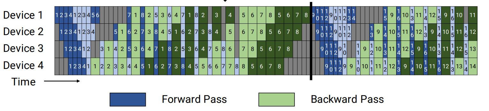

# Virtual Pipeline Parallelism (VPP)

## Problem Analysis

The Pipedream pipeline parallelism has an excessively large partitioning granularity, resulting in many bubbles during execution. There is still room for improvement in computational resource utilization.

## Solution

Further refine computation to reduce bubbles.

### Technical Approach

With the number of devices unchanged, create more pipeline stages, trading increased communication overhead for a reduced bubble ratio.



For more details, see [the paper](https://dl.acm.org/doi/10.1145/3458817.3476209).

For easy understanding, here is an example: The Qwen2vl-7B model has 32 vision module layers and 28 language module layers. Set tensor parallelism size to 1, pipeline parallelism size to 4, and virtual pipeline parallelism size to 3. The model will be divided into `4 * 3 = 12` stages. The number of layers in each stage can be customized, supporting non-uniform partitioning.

The partitioning of the vision module: `[[10, 10, 10, 2],[0, 0, 0, 0],[0, 0, 0, 0]]`,

The partitioning of the language module: `[[0, 0, 0, 1],[4, 4, 4, 4],[4, 3, 2, 2]]`

The following shows the model layer distribution for each device and each VPP stage, where `D` represents device and `V` represents VPP.

    D0V0: 10 ViT layers + 0 LLM layers
    D0V1: 0 ViT layers + 4 LLM layers
    D0V2: 0 ViT layers + 4 LLM layers
    D1V0: 10 ViT layers + 0 LLM layers
    D1V1: 0 ViT layers + 4 LLM layers
    D1V2: 0 ViT layers + 3 LLM layers
    D2V0: 10 ViT layers + 0 LLM layers
    D2V1: 0 ViT layers + 4 LLM layers
    D2V2: 0 ViT layers + 2 LLM layers
    D3V0: 2 ViT layers + 1 LLM layer
    D3V1: 0 ViT layers + 4 LLM layers
    D3V2: 0 ViT layers + 2 LLM layers

The forward order is: D0V0 -> D1V0 -> D2V0 -> D3V0 -> D0V1 -> D1V1 -> D2V1 -> D3V1 -> D0V2 -> D1V2 -> D2V2 -> D3V2

## Use Case

To further reduce the bubble ratio and improve performance

## How to Use

Taking Qwen2vl-7B as an example:

1. Configure the VPP partitioning rule and run the weight conversion tool:

    ```shell
    mm-convert  Qwen2VLConverter hf_to_mm \
    --cfg.mm_dir "ckpt/mm_path/Qwen2-VL-7B-Instruct-vpp" \
    --cfg.hf_config.hf_dir "ckpt/hf_path/Qwen2-VL-7B-Instruct" \
    --cfg.parallel_config.llm_pp_layers [[0,0,0,1],[4,4,4,4],[4,3,2,2]] \
    --cfg.parallel_config.vit_pp_layers [[10,10,10,2],[0,0,0,0],[0,0,0,0]] \
    --cfg.parallel_config.tp_size 1
    ```

2. Modify `pipeline_num_layers` in `model.json`. It must be consistent with the layers used during weight conversion. Take Qwen2vl-7B as an example:

    ```shell
    # text_decoder
    "pipeline_num_layers": [[0, 0, 0, 1],[4, 4, 4, 4],[4, 3, 2, 2]]

    # vision_encoder
    "pipeline_num_layers": [[10, 10, 10, 2],[0, 0, 0, 0],[0, 0, 0, 0]]
    ```

3. Add the VPP parameters to the shell script. Because Megatron natively supports only uniform VPP partitioning, to support non-uniform VPP partitioning you need to export the `VP_SIZE` variable in the shell, where `VP_SIZE` equals the length of `pipeline_num_layers`. The `--virtual-pipeline-model-parallel-size 3` parameter is also used to enable the VPP feature, and its value is the same as `VP_SIZE`.

    ```shell
    export VP_SIZE=3
    GPT_ARGS="
        --virtual-pipeline-model-parallel-size 3
        ..."
    ```

## Effectiveness

The bubble ratio is further reduced.

## Notes

1. MindSpeed MM optimizes VPP and supports non-uniform partitioning. You can modify the weight conversion script, `model.json`, and the shell script to customize the VPP partitioning method.

2. Megatron VPP affects the weight partitioning method. The VPP configurations must be consistent when saving and loading weights so that they can be loaded properly.
