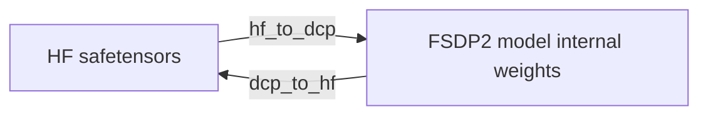

# MindSpeed MM Weight Loading and Saving Guide

This document describes the adaptation scenarios of the Hugging Face (hereinafter referred to as HF) and PyTorch Distributed Checkpoint (hereinafter referred to as DCP) weight formats used by the MindSpeed MM FSDP2 backend, the configuration process for loading and saving weights, and the adaptation process used when the original weight layout is inconsistent with the model layout.

## Adaptation Scenarios

### HF Weights

HF weights are usually stored as `model.safetensors` or multiple safetensors shards, together with model resource files such as `config.json`, the weight index, the tokenizer, and the processor. The HF format has good versatility and is suitable for the following scenarios:

- Obtaining pretrained models from Hugging Face or ModelScope
- Exporting trained models for inference, evaluation, or release

### DCP Weights

DCP is the native distributed checkpoint format of PyTorch. It can save and load model weights in FSDP2 shards and supports saving training iteration information, optimizer state, and random number state. It applies to the following scenarios:

- Loading large models by shard after initialization with meta device, reducing memory usage during the initialization phase.
- Saving the complete training state during FSDP2 distributed training, so that the data iteration position, optimizer state, and random number state can be restored for checkpoint resumption.

## Configuration Method

During training, you can select how weights are loaded and saved through the `training.load_format` and `training.save_format` parameters in the model YAML configuration file. Currently, `hf`, `dcp`, and `auto` are supported. When the weight load format is set to `auto`, the `hf` or `dcp` format is selected automatically based on the type of weight files in the load path. When the weight save format is set to `auto`, the weight save type is consistent with the load type; in checkpoint resumption scenarios (that is, when the optimizer and random number states are saved), the weight save format is uniformly changed to the DCP format.

### HF Weight Loading and Saving

When `training.load_format` and `training.save_format` are set to `hf`, the framework converts between the HF and DCP weight formats through the online conversion process. If the model weight layout differs from the original HF weight layout, the online conversion also completes the layout conversion through the dedicated weight conversion pipeline `WeightTransformPipeline`. The configuration method is as follows:

```yaml
model:
  model_id: qwen3_5_moe  # The corresponding weight conversion pipeline is selected based on model_id during online conversion

training:
  # HF weight loading
  load: /hf_load_path
  load_format: hf
  no_load_optim: true  # The optimizer state cannot be loaded when loading HF weights
  no_load_rng: true  # The random number state cannot be loaded when loading HF weights

  # HF weight saving
  save: ./hf_save_path
  save_interval: 1000
  save_format: hf
  no_save_optim: true  # The optimizer state cannot be saved when saving HF weights
  no_save_rng: true  # The random number state cannot be saved when saving HF weights
```

### DCP Weight Loading and Saving

When `training.load_format` and `training.save_format` are set to `dcp`, you need to convert the HF weights to the DCP format offline first, and then load them from DCP shards. If the model weight layout differs from the original HF weight layout, the offline conversion also reuses the weight conversion pipeline to complete the layout conversion.

Using Qwen3.5 MoE as an example, first perform the offline HF to DCP conversion:

```bash
# Modify the ascend-toolkit path based on the actual environment
source /usr/local/Ascend/cann/set_env.sh
export NON_MEGATRON=true

python -m mindspeed_mm.fsdp.tasks.checkpoint.converter hf_to_dcp \
    --model_id qwen3_5_moe \
    --hf_dir /path/to/hf_model \
    --dcp_dir /path/to/dcp_model \
    --num_workers 0

# Where:
# model_id: Model name, used to select the weight conversion pipeline
# hf_dir: HF weight path
# dcp_dir: Save path of the converted DCP weights
# num_workers: Number of parallel worker threads. 0 means serial execution. If storage I/O performance allows, you can increase the concurrency appropriately to improve conversion efficiency. The recommended value is 4
```

After the conversion is complete, point `training.load` to the root directory of the converted DCP weights and configure the related parameters:

```yaml
training:
  # DCP weight loading
  load: ./dcp_load_path
  load_format: dcp
  no_load_optim: true  # Set to false during checkpoint resumption to load the optimizer state
  no_load_rng: true  # Set to false during checkpoint resumption to load the random number state

  # DCP weight saving
  save: ./dcp_save_path
  save_interval: 1000
  save_format: dcp
  no_save_optim: true  # Set to false during checkpoint resumption to save the optimizer state
  no_save_rng: true  # Set to false during checkpoint resumption to save the random number state
```

After the DCP weights are saved, you can convert them back to HF weights with the following command:

```bash
# Modify the ascend-toolkit path based on the actual environment
source /usr/local/Ascend/cann/set_env.sh
export NON_MEGATRON=true

python -m mindspeed_mm.fsdp.tasks.checkpoint.converter dcp_to_hf \
    --model_id qwen3_5_moe \
    --dcp_dir /path/to/dcp_model/iter_000xx \
    --hf_dir /path/to/hf_model \
    --origin_hf_dir /path/to/origin_hf_model \
    --to_bf16 \
    --keep_origin_mtp_weights \
    --num_workers 0

# Where:
# model_id: Model name, used to select the weight conversion pipeline
# dcp_dir: Path of the saved DCP-format weights, where `iter_000xx` indicates the weights saved at step xx
# hf_dir: Save path of the converted HF-format weights
# origin_hf_dir: Path of the original HF-format weights
# to_bf16: When enabled, converts the weight data type from FP32 precision to BF16 precision
# keep_origin_mtp_weights: When enabled, retains the MTP-related weights in the original HF weights if the DCP does not contain MTP weights
# num_workers: Number of parallel worker threads. 0 means serial execution. If storage I/O performance allows, you can increase the concurrency appropriately to improve conversion efficiency. The recommended value is 4
```

### Parameter Description

The following describes the meanings of the parameters related to weight loading and saving in the `training` configuration section:

| Parameter | Type | Default Value | Description |
| :--- | :--- | :--- | :--- |
| `load` | string \| null | `null` | Path of the weights to be loaded. |
| `load_format` | string | `auto` | Weight load type. Valid values are `hf`, `dcp`, and `auto`. When set to `auto`, the weight type is identified automatically based on the file type in the `load` path. |
| `no_load_optim` | bool | `false` | Whether to skip loading the optimizer state. Set it to `false` when loading DCP weights for checkpoint resumption, and it must be set to `true` when loading HF weights. |
| `no_load_rng` | bool | `false` | Whether to skip loading the random number state. Set it to `false` when loading DCP weights for checkpoint resumption, and it must be set to `true` when loading HF weights. |
| `save` | string \| null | `null` | Weight save path. |
| `save_interval` | int | `1` | Training iteration interval for saving weights. |
| `save_format` | string | `auto` | Weight save type. Valid values are `hf`, `dcp`, and `auto`. When set to `auto`, the save type is consistent with the load type, and it is uniformly changed to the `dcp` format when checkpoint resumption is enabled. |
| `no_save_optim` | bool | `false` | Whether to skip saving the optimizer state. Set it to `false` when saving DCP weights for checkpoint resumption; when it is set to `false`, the weight save type is automatically changed to the DCP format. |
| `no_save_rng` | bool | `false` | Whether to skip saving the random number state. Set it to `false` when saving DCP weights for checkpoint resumption; when it is set to `false`, the weight save type is automatically changed to the DCP format. |

## Adaptation Scope

When the HF weight layout is inconsistent with the model weight layout, online HF weight loading and offline DCP weight conversion need to complete the layout conversion through the conversion pipeline. The models adapted so far are listed below:

| Backend | Model | Conversion Content |
| :--- | :--- | :--- |
| FSDP2 | Qwen3.5 MoE | Dimension permutation of MoE expert weights; merging and splitting of MTP expert weights. |

If the HF weight keys, tensor shapes, and internal model parameters are completely identical, the format conversion can be performed directly without adding conversion rules. To add a new conversion pipeline, follow the adaptation process below.

## Conversion Pipeline Adaptation

The weight conversion pipeline `WeightTransformPipeline` is the adaptation layer between HF weights and the internal weights of the FSDP2 model. The `hf_to_dcp` method is called during online HF weight loading or offline HF-to-DCP conversion. The `dcp_to_hf` method is called during online HF weight saving or offline DCP-to-HF conversion.



### Conversion Pipeline Implementation

Add a new model weight conversion pipeline in `mindspeed_mm/fsdp/checkpoint/convert.py` and inherit from `WeightTransformPipeline`:

```python
class NewModelWeightTransformPipeline(WeightTransformPipeline):
    def __init__(self, **kwargs) -> None:
        super().__init__()

    def hf_to_dcp(
        self,
        key: str,
        tensor: torch.Tensor,
    ) -> Optional[Tuple[str, torch.Tensor]]:
        # Convert the HF key/tensor to the model internal key/tensor
        return key, tensor

    def dcp_to_hf(
        self,
        key: str,
        tensor: torch.Tensor,
    ) -> Dict[str, torch.Tensor]:
        # Restore the model internal weights to one or more HF weights
        return {key: tensor}
```

`hf_to_dcp` receives a single HF key/tensor and returns the converted target key/tensor. If the weight needs to be skipped or needs to wait for other tensors to be merged, it returns `None`. `dcp_to_hf` receives the model internal weights and returns a `{hf_key: tensor}` dictionary.

The conversion functions that can be reused at present are as follows:

| Conversion Function | Conversion Type | Description |
| :--- | :--- | :--- |
| `permute_moe_expert` | Dimension permutation of MoE expert weights | Performs dimension permutation on weights that match the regular expression, and leaves unmatched weights unchanged. |
| `reshape_fused_linear` | Flattening of fused Linear weights | Reshapes the matching weights from `[E, input_dim, output_dim]` to `[E × input_dim, output_dim]`. |
| `rename_key` | Renaming of weight key prefixes | Replaces the HF key prefix with the model internal prefix; when the HF prefix is empty, adds the internal prefix before the original key. |
| `merge_moe_expert_weights` | Merging of MoE expert weights | Merges the independent `gate_proj` and `up_proj` of each expert into a fused `gate_up_proj`, and merges the `down_proj` of each expert. |
| `split_moe_expert_weights` | Splitting of MoE expert weights | Restores the fused expert weights to the HF weights of each expert. |

### Conversion Pipeline Registration

After the implementation is complete, add the mapping between the model identifier and the conversion pipeline in the `WEIGHT_TRANSFORM_PIPELINES` dictionary in `mindspeed_mm/fsdp/checkpoint/convert.py`:

```python
WEIGHT_TRANSFORM_PIPELINES = {
    "model_id": NewModelWeightTransformPipeline,
}
```

The key in the dictionary must be consistent with `model.model_id` in the YAML configuration. The framework selects the conversion pipeline used for online loading and saving based on this field.

## Notes

- When the parameter scale is small and no layout conversion is required or the conversion logic is simple, it is recommended to use online HF weight loading. For large models or complex conversion logic, it is recommended to first convert the original HF weights to DCP weights offline, so as to avoid a long startup time caused by converting a large number of HF weights on every startup.
- The HF save format supports saving only model weights, and does not support saving the optimizer state or the random number state. If checkpoint resumption is required, save the weights in the DCP format.
