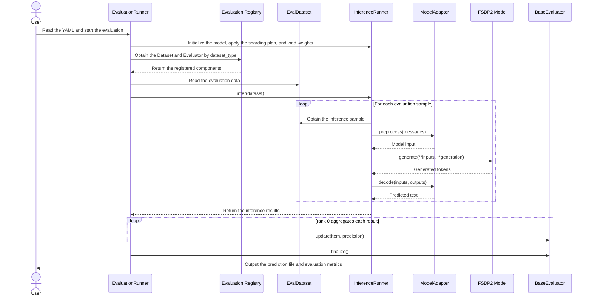

# MindSpeed MM Evaluation Framework Usage Guide

This document describes the MindSpeed MM evaluation framework based on the PyTorch FSDP2 backend. It mainly demonstrates a concrete evaluation example, including evaluation dataset preparation, script configuration, and supported scope, and provides the adaptation process for integrating a new evaluation task into the framework.

## Example

Before running an evaluation task, prepare the evaluation data and create the launch script and the corresponding configuration file. The following example evaluates the Qwen3.5 MoE model on the VQA v2.0 validation set. Complete the environment setup described in the model README before running.

### Dataset Preparation

Download the questions and annotations of the VQA v2.0 validation set and the COCO 2014 validation images from [VQA v2.0](https://visualqa.org/download.html), and organize them into the following directory:

```text
data/vqa2_val/
├── v2_OpenEnded_mscoco_val2014_questions.json
├── v2_mscoco_val2014_annotations.json
└── val2014/
    ├── COCO_val2014_000000000042.jpg
    ├── COCO_val2014_000000000073.jpg
    └── ...
```

The built-in `VQA2ValDataset` reads the questions and annotations, constructs image paths under `val2014` based on `image_id`, and appends the following answer constraint to each question:

```text
Answer the question using a single word or phrase.
```

### Script Startup

Create `examples/qwen3_5/qwen3_5_moe_evaluation.sh`. The configuration file path `config_path` in the script must be the same as the path of the configuration file you create:

```bash
# Modify the ascend-toolkit path as required
source /usr/local/Ascend/cann/set_env.sh
export NON_MEGATRON=true
export MULTI_STREAM_MEMORY_REUSE=2
export TASK_QUEUE_ENABLE=2
export ASCEND_LAUNCH_BLOCKING=0
export ACLNN_CACHE_LIMIT=100000
export CPU_AFFINITY_CONF=1
export PYTORCH_NPU_ALLOC_CONF=expandable_segments:True

NPUS_PER_NODE=8
MASTER_ADDR=localhost
MASTER_PORT=6000
NNODES=1
NODE_RANK=0
WORLD_SIZE=$(($NPUS_PER_NODE*$NNODES))

DISTRIBUTED_ARGS="
    --nproc_per_node $NPUS_PER_NODE \
    --nnodes $NNODES \
    --node_rank $NODE_RANK \
    --master_addr $MASTER_ADDR \
    --master_port $MASTER_PORT
"

logfile=$(date +%Y%m%d)_$(date +%H%M%S)
config_path=examples/qwen3_5/qwen3_5_moe_evaluation.yaml
mkdir -p logs
torchrun $DISTRIBUTED_ARGS mindspeed_mm/fsdp/evaluation/evaluation_runner.py \
    ${config_path} \
    2>&1 | tee logs/eval_${logfile}.log
```

### Configuration File

Create `examples/qwen3_5/qwen3_5_moe_evaluation.yaml` and replace the model path and dataset path with actual paths:

```yaml
parallel:
  fully_shard_parallel_size: auto
  fsdp_plan:
    apply_modules:
      - model.language_model.embed_tokens
      - model.language_model
      - model.language_model.layers.{*}
      - model.language_model.layers.{*}.linear_attn
      - model.language_model.layers.{*}.mlp.experts
      - lm_head
      - mtp
    hook_modules:
      - model.language_model.layers.{*}
    param_dtype: bf16
    reduce_dtype: fp32
    reshard_after_forward: true
    num_to_forward_prefetch: 1
    num_to_backward_prefetch: 0
    cpu_offload: false
  ulysses_parallel_size: 1
  expert_parallel_size: 1
  ep_plan:
    apply_modules:
      - model.language_model.layers.{*}.mlp.experts
    dispatcher: alltoall

model:
  model_id: qwen3_5_moe
  model_name_or_path: &HF_MODEL_LOAD_PATH /path/to/Qwen3.5-MoE  # Replace with the hf weight path
  trust_remote_code: true
  attn_implementation: flash_attention_2
  gdn_implementation: ascendc
  causal_conv1d_implementation: ascendc
  use_grouped_expert_matmul: true

inference:
  load: /path/to/Qwen3.5-MoE  # Replace with the hf weight path
  load_format: auto
  init_model_with_meta_device: true
  seed: 42
  use_deter_comp: false
  adapter: qwen3_5_moe
  processor_path: *HF_MODEL_LOAD_PATH
  enable_thinking: false
  generation:
    max_new_tokens: 32
    do_sample: false
    repetition_penalty: 1.0
    use_cache: true
  plugin:
    - mindspeed_mm/fsdp/models/qwen3_5_moe

evaluation:
  dataset_type: vqa2_val
  dataset_path: ./data/vqa2_val  # Replace with the dataset path
  max_samples: null
  result_output_path: ./evaluation_outputs
```

### Parameter Description

The following describes the parameters in the `evaluation` section:

| Parameter | Type | Default Value | Description |
| :--- | :--- | :--- | :--- |
| `dataset_type` | str | `vqa2_val` | Registered name of the evaluation task, used to select the evaluation dataset and evaluator. It must be the same as the keys registered in `eval_dataset_dict` and `eval_impl_dict`. |
| `dataset_path` | str | — | Root directory or data file path of the evaluation dataset. |
| `max_samples` | int \| null | `null` | Maximum number of samples to evaluate. `null` means the full evaluation dataset is used. Set a small value when debugging the feature. |
| `result_output_path` | str | `./evaluation_outputs` | Directory for saving prediction results and evaluation metrics. |

### Evaluation

Run the following command in the repository root directory to perform evaluation:

```bash
bash examples/qwen3_5/qwen3_5_moe_evaluation.sh
```

### Output

After the evaluation is complete, the results are generated in the path specified by `evaluation.result_output_path`:

```text
evaluation_outputs/
├── qwen3_5_moe_vqa2_val_predictions.json
└── qwen3_5_moe_vqa2_val_metrics.json
```

The prediction file stores `question_id` and the model answer. The metrics file contains the following:

- `overall`: accuracy of all questions
- `answer_type`: accuracy by answer type
- `question_type`: accuracy by question type

The content of the prediction result file is as follows:

```json
[
  {
    "question_id": 262148000,
    "answer": "down"
  },
  {
    "question_id": 262148001,
    "answer": "watching"
  },
  {
    "question_id": 262148002,
    "answer": "picnic table"
  },
  {
    "question_id": 393225000,
    "answer": "[http://foodiebaker.com](http://foodiebaker.com)"
  }
]
```

The content of the evaluation metrics file is as follows:

```json
{
  "overall": 87.1,
  "answer_type": {
    "number": 90.0,
    "other": 77.21,
    "yes/no": 96.5
  },
  "question_type": {
    "are the": 100.0,
    "are there": 86.67,
    "are there any": 100.0,
    "are these": 30.0,
    "can you": 100.0,
    "could": 100.0,
    "does the": 100.0,
    "does this": 100.0,
    "has": 100.0,
    "how many": 89.38,
    "how many people are": 100.0,
    "is it": 100.0,
    "is that a": 100.0,
    "is the": 96.67,
    "is there a": 100.0,
    "is this": 100.0,
    "is this a": 100.0,
    "is this an": 100.0,
    "is this person": 100.0,
    "none of the above": 72.5,
    "what": 15.0,
    "what are the": 100.0,
    "what color are the": 100.0,
    "what color is the": 86.67,
    "what does the": 76.67,
    "what is": 84.0,
    "what is on the": 100.0,
    "what is the": 66.67,
    "what is the color of the": 100.0,
    "what is the man": 95.0,
    "what is this": 100.0,
    "what kind of": 76.67,
    "what type of": 100.0,
    "where is the": 30.0,
    "which": 100.0,
    "who is": 90.0,
    "why": 30.0,
    "why is the": 60.0
  }
}
```

The console also prints the result file paths and the final evaluation metrics.

## Supported Scope

The evaluation datasets and metrics that the current evaluation framework supports and has verified are as follows:

| Evaluation Dataset | Registered Name | Metrics | Description |
| :--- | :--- | :--- | :--- |
| VQA v2.0 validation set | `vqa2_val` | `overall`, `answer_type`, `question_type` | Calculates the overall accuracy according to the official VQA v2.0 scoring rules and summarizes it by answer type and question type, respectively. |

To add a new evaluation dataset and metrics, follow the adaptation process described below.

## Evaluation Task Adaptation

### Evaluation Framework

The evaluation framework reuses the inference framework to build the model, shard with FSDP2, load weights, and generate text. It converts the raw evaluation dataset into inference samples and calls the evaluator `BaseEvaluator` to complete the evaluation task:



Here, the evaluation dataset provides the inference inputs and sample annotations, and the evaluator `BaseEvaluator` receives the model predictions, accumulates the evaluation state, computes the metrics, and saves the results. When adding an evaluation task, you need to adapt both the evaluation dataset and the evaluator.

### Evaluation Dataset Adaptation

Add a new evaluation dataset in `mindspeed_mm/fsdp/evaluation/eval_datasets/<dataset_name>.py`:

```python
class NewEvalDataset:
    def __init__(
        self,
        dataset_path: str,
        max_samples: Optional[int] = None,
    ) -> None:
        # Load the data and truncate samples based on max_samples
        ...

    def __len__(self) -> int:
        ...

    def __getitem__(self, index: int) -> dict[str, Any]:
        return {
            # Fields used by the inference framework
            "text": ...,
            "image": ...,

            # Sample identifier and annotation fields used by the evaluator
            "sample_id": ...,
            "answers": ...,
        }
```

The evaluation dataset must accept the `dataset_path` and `max_samples` parameters and return the inference input, the sample identifier, and the annotation fields required for computing the metrics for each sample.

### Evaluator Adaptation

Add a new evaluator in `mindspeed_mm/fsdp/evaluation/eval_impl/<dataset_name>.py` and inherit from `BaseEvaluator`:

```python
class NewEvaluator(BaseEvaluator):
    def __init__(
        self,
        result_output_path: str,
        model_name: str,
        dataset_name: str,
    ) -> None:
        ...

    def update(self, item: dict[str, Any], prediction: str) -> None:
        # Update the evaluation state with the sample annotations and model output
        ...

    def finalize(self) -> dict[str, Any]:
        # Compute and save the evaluation results, and return the metrics dictionary
        ...
```

The evaluator must implement the following methods:

- `update`: called after the inference of each sample is complete; collects the prediction results and updates the evaluation state.
- `finalize`: called after the inference of all samples is complete; computes the final metrics, saves the result file, and returns the metrics dictionary.

### Registering an Evaluation Task

After adapting the evaluation dataset and the evaluator, register them in the corresponding `__init__.py` files with the same key:

```python
# mindspeed_mm/fsdp/evaluation/eval_datasets/__init__.py
from .new_dataset import NewEvalDataset


eval_dataset_dict = {
    ...,
    "new_eval": NewEvalDataset,
}
```

```python
# mindspeed_mm/fsdp/evaluation/eval_impl/__init__.py
from .new_evaluator import NewEvaluator


eval_impl_dict = {
    ...,
    "new_eval": NewEvaluator,
}
```

In a specific evaluation process, you can select the evaluation task by adjusting the `evaluation.dataset_type` field in the configuration file. The value of this field must be the same as the keys registered in `eval_dataset_dict` and `eval_impl_dict`.

## Notes

This evaluation process applies only to effect verification and result comparison during model training and is not performance-optimized for online deployment. If your service scenario requires performance acceleration, it is recommended to use a professional inference acceleration library and the corresponding optimization components for deployment.
