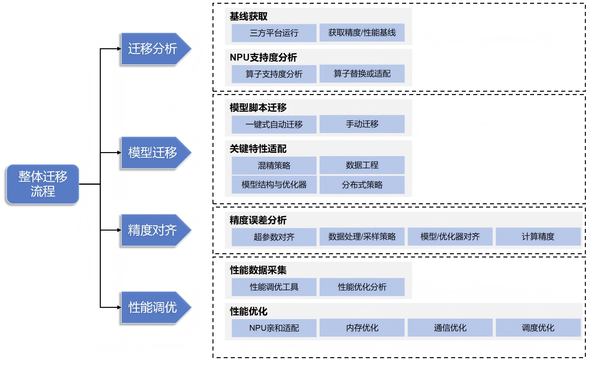
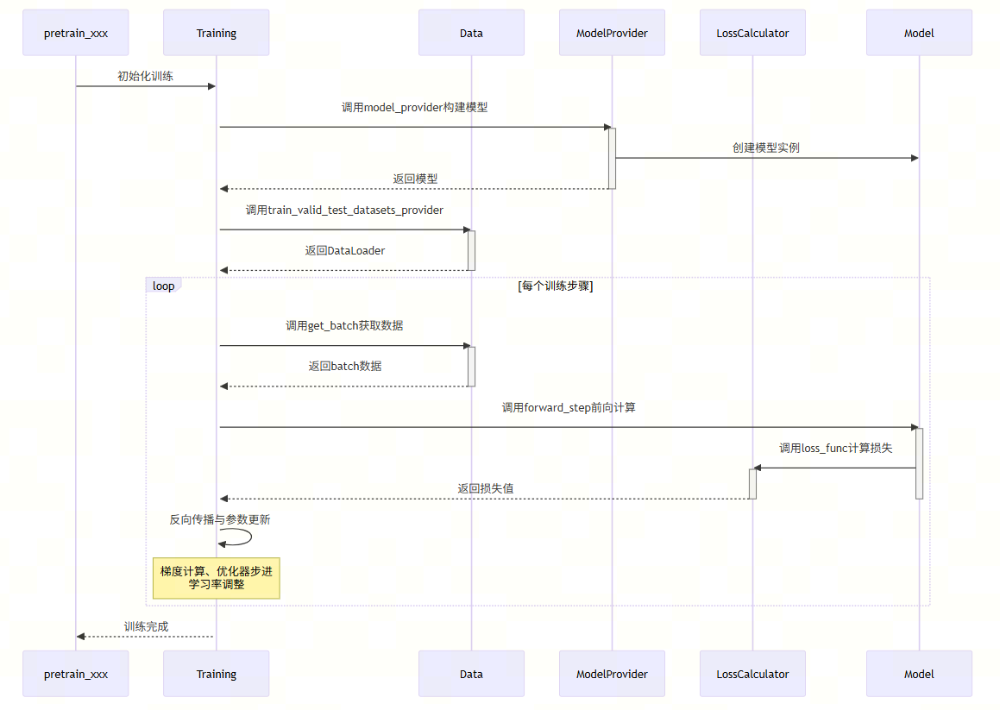
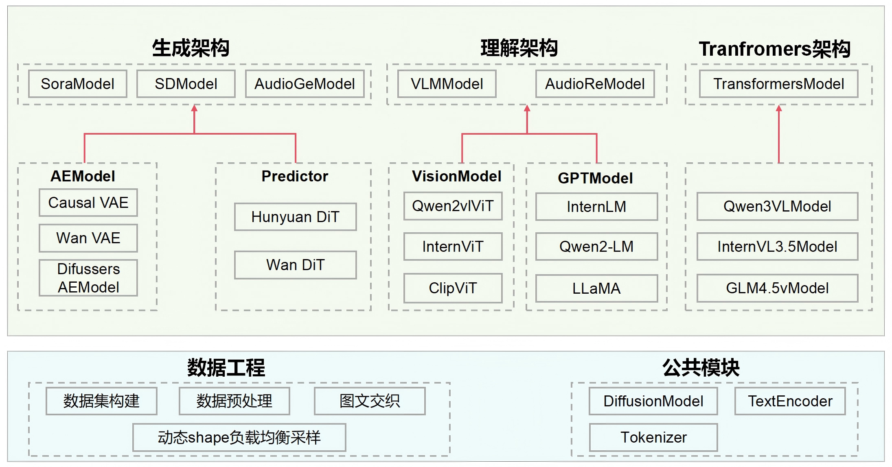
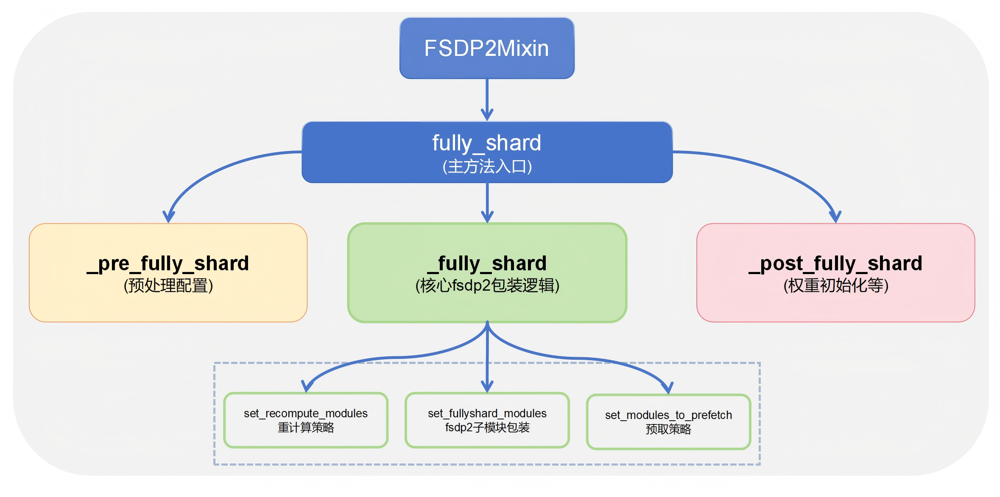

# Model Migration

Last updated: 12/08/2025. Author: zs-derrick

## Background

This document describes how to migrate a multimodal model from other hardware devices and software frameworks to NPU hardware and the FSDP2 backend of the MindSpeed MM framework.

## Overall Migration Workflow

Migrating a model from other hardware devices and software frameworks to MindSpeed MM requires a series of adaptation tasks ranging from the underlying hardware to the upper-layer framework. Taking GPU as an example, **these adaptation tasks mainly stem from three core differences:**

- **Differences in hardware characteristics and performance features**: Since the hardware characteristics and performance features of NPUs and GPUs differ, a model may require further performance debugging and optimization on NPUs in order to fully exploit NPU potential.
- **Differences in computing architecture**: GPUs use the CUDA (Compute Unified Device Architecture) parallel computing architecture, whereas Huawei NPUs use the CANN (Compute Architecture for Neural Networks) heterogeneous computing architecture.
- **Differences in deep learning frameworks**: Different frameworks have subtle implementation differences in training details such as the automatic differentiation mechanism, mixed precision implementation, gradient accumulation strategy, optimizer update method, and distributed strategy. These differences directly affect model convergence behavior and require refined verification and adaptation.

The following figure shows the overall model migration flowchart:



To complete the above adaptation work systematically, we break the model migration process into four key stages:

1. **Migration preparation**: Select a suitable model based on business requirements, ensure that it runs successfully on a third-party platform (such as GPU), and establish a performance/precision baseline; prepare the NPU environment, use the [migration analysis tool](https://www.hiascend.com/document/detail/en/Pytorch/730/ptmoddevg/trainingmigrguide/PT_LMTMOG_0007.html) to collect the model operator list, analyze NPU operator support, and formulate replacement or development adaptation plans for unsupported operators.
2. **Model migration**: Through [model script migration](https://www.hiascend.com/document/detail/en/Pytorch/730/ptmoddevg/trainingmigrguide/PT_LMTMOG_0012.html), perform migration analysis on key modules such as model structure, data engineering, and distributed training strategy.
3. **Precision alignment**: Use the [precision analysis tool](https://www.hiascend.com/document/detail/en/CANNCommunityEdition/850/devaids/ModelAccuracyAnalyzer/atlasaccuracy_16_1000.html) to systematically analyze the sources of precision error, and ensure precision consistency before and after migration across dimensions such as hyperparameters, data processing, model/optimizer, and computation precision.
4. **Performance tuning**: Use the [performance tuning tool](https://www.hiascend.com/document/detail/en/CANNCommunityEdition/850alpha001/devaids/Profiling/atlasprofiling_16_0001.html) to systematically analyze model performance and locate bottleneck modules; based on [performance tuning methods](https://www.hiascend.com/document/detail/en/Pytorch/730/ptmoddevg/trainingmigrguide/performance_tuning_0024.html), implement targeted optimization across dimensions such as NPU affinity adaptation, memory optimization, communication optimization, and scheduling optimization.

## MindSpeed MM Architecture Migration Guide

MindSpeed MM adopts a modular architecture design, with the training entry script at its core and configuration-driven unified training of multimodal models. Its core characteristic is that **training logic is decoupled from model implementation**—the main training flow is fixed in `pretrain_xxx.py`, while key components such as model structure, data processing, and loss computation are injected through callback functions, which gives the framework high extensibility.

### 🎯 Quick Start

The training logic of MindSpeed MM follows the Megatron style overall. All models are launched uniformly through `pretrain_xxx.py` files, and the training process is controlled by the configuration files in the `examples` directory. When migrating, focus on the following core modules:

1. **Select the entry script**: `pretrain_xxx.py` in the root directory (such as `pretrain_vlm.py`)
2. **Configure training parameters**: Modify the configuration files under `examples/model_name/`
3. **Implement callback functions**: Implement the core functions in the entry script

### 📁 Structure Overview

| Module Type | Submodule/File | Path | Function Description |
| --- | --- | --- | --- |
| **Training entry file** | Main training script | `pretrain_xxx.py` (root directory) | Such as pretrain_sora.py, pretrain_vlm.py, and so on |
| **Example configuration directory (overview)** | Model configuration directory | `examples/` (root directory) | Training configuration directory for a specific model, such as examples/qwen3vl/ |
| **Example configuration directory (data)** | Data configuration file | `examples/model_name/data.json` | Defines the dataset path, preprocessing method, data augmentation strategy, and so on |
| **Example configuration directory (model)** | Model configuration file | `examples/model_name/model.json` | Defines the model architecture, parameters, and so on |
| **Example configuration directory (launch)** | Launch script | `examples/model_name/pretrain.sh` | Training launch script, including the execution command and parameter settings |
| **Core source directory** | Data processing module | `mindspeed_mm/data/` | Implementations of data loading, preprocessing, augmentation, sampling, and other functions |
| **Core source directory** | Model structure module | `mindspeed_mm/model/` | Implementations of various model components, including encoders, decoders, vision modules, and so on |

### 🚀 Core Interface Adaptation

`pretrain_xxx.py` provides the main (callback) functions involved in model training. Users need to implement the corresponding business logic in these functions according to specific task requirements. These functions are called automatically during training:

| Function | Description |
| --- | --- |
| model_provider | Build the model |
| get_batch | Build the forward input data of the model |
| loss_func | Compute the model forward loss |
| forward_step | Run the model forward pass and compute the loss |
| train_valid_test_datasets_provider | Build the data loaders |

### 🔄 Core Interface Call Flow

<!--  -->

## Model Migration

The key points of the overall migration revolve around the core interfaces in section 2.3.

### ⚙️ Environment Setup

[It is recommended to use the matching environment versions when developing a model.]

<!-- Refer to the [Environment Setup](<>) section to complete the basic environment setup of HDK, CANN, PyTorch, and TorchNPU. -->

> Python 3.12 is recommended, and torch and TorchNPU 2.10.0 are recommended

```bash
git clone https://gitcode.com/Ascend/MindSpeed-MM.git
git clone https://github.com/NVIDIA/Megatron-LM.git  # Third-party repository
cd Megatron-LM
git checkout core_v0.12.1
cp -r megatron ../MindSpeed-MM/
cd ..
cd MindSpeed-MM
mkdir logs data ckpt

# Install the acceleration library
git clone https://gitcode.com/Ascend/MindSpeed.git
cd MindSpeed
# checkout commit from MindSpeed 26.0.0_core_r0.12.1
git checkout xxxxxxx  # Replace with the actual commit hash

# Install mindspeed and its dependencies
pip install -e .
cd ..
# Install mindspeed mm and its dependencies
pip install -e .
```

### 📊 Data Module Migration

#### Basic Migration Principles

The MindSpeed MM framework provides high compatibility for data modules, so users' existing `DataSet` and `DataLoader` implementations can be migrated seamlessly.

**Quick migration steps:**

1. **Keep the existing implementation**: User-defined `DataSet`, `DataLoader`, and other data modules require no modification
2. **Register the data provider function**: Return the `DataLoader` data objects through the `train_valid_test_datasets_provider` function of the entry script
3. **Obtain the training batch**: Process the current training batch data in the `get_batch` function

**Migration example:**

```python
def train_valid_test_datasets_provider():
    """Build train, valid, and test datasets."""
    # Return your existing dataset instances
    train_dataloader = build_dataloader(CustomDataset(...))
    valid_dataloader = build_dataloader(CustomDataset(...))
    test_dataloader = build_dataloader(CustomDataset(...))

    return train_dataloader, valid_dataloader, test_dataloader

def get_batch(data_iterator, args):
    """Generate a batch."""
    if data_iterator is not None:
        batch = next(data_iterator)
    else:
        raise ValueError("Data iterator is None. Unable to retrieve batch.")
    move_to_device(batch, get_args().params_dtype)

    return batch
```

**LlamaFactory Data Format Migration**

If you are migrating a model from LlamaFactory, you need to convert the LlamaFactory data format into a format supported by MindSpeed MM.

**Format comparison:**

- **LlamaFactory format (OpenAI content list):**

```json
{
  "messages": [
    {"role": "user", "content": [
      {"type": "image", "image": "a.jpg"},
      {"type": "text", "text": "Please describe the image"}
    ]},
    {"role": "assistant", "content": [{"type": "text", "text": "This is an image..."}]}
  ]
}
```

- **MindSpeed MM format (sharegpt + `<image>` placeholder):**

```json
{
  "images": ["a.jpg"],
  "messages": [
    {"role": "user",      "content": "<image>\nPlease describe the image"},
    {"role": "assistant", "content": "This is an image..."}
  ]
}
```

**Conversion script example:**

```shell
python mindspeed_mm/fsdp/tools/data_tool/llava_instruct_2_mllm_demo_format.py
```

#### Using Native Data Components

MindSpeed MM also provides an optimized set of multimodal dataset processing modules, including `build_mm_dataset`, `build_mm_dataloader`, and so on. Users can flexibly define data sources, preprocessing flows, and loading strategies through the `data.json` configuration file.

### 🧩 Model Structure Migration

<!--  -->

In the MindSpeed MM framework, all training models are built and executed through standardized entry functions: `model_provider` builds the model, `forward_step` executes the forward pass, and `loss_func` computes the training loss.

```python
def model_provider(*args, **kwargs):
    model = CustomModel(config)  # User-defined model class
    return model

def loss_func(output_tensor):
    # Compute the loss based on the model output
    loss = compute_loss(output_tensor)
    return loss

def forward_step(data_iterator, model):
    """Forward step."""
    batch_data = get_batch(data_iterator)
    output_tensor = model(**batch_data)
    return output_tensor, loss_func
```

### ⚖️ Weight Conversion

Models trained with FSDP2 in the MindSpeed MM repository load and save model files in DCP format, so the model weight files must be converted before training.

The following is a weight conversion example for Qwen3-vl:

```shell
mm-convert GenericDCPConverter hf_to_dcp \
    --hf_dir ckpt/Qwen3-VL-30B-Instruct \
    --dcp_dir ckpt/Qwen3-VL-30B-Instruct-dcp

# The converted directory structure is:
# ———— xxxxxxx
#   |—— release
#   |—— latest_checkpointed_iteration.txt
```

### 📜 Launch Command Configuration

The launch method of MindSpeed MM training is consistent with Megatron. The following is a training launch script example, including distributed parameters, model parameters, multimodal parameters, and output configuration.

#### Configuration Details

**1. Distributed parameters**

```bash
DISTRIBUTED_ARGS="
    --nproc_per_node $NPUS_PER_NODE     # Number of GPUs per node
    --nnodes $NNODES                    # Total number of nodes
    --node_rank $NODE_RANK              # Rank of the current node
    --master_addr $MASTER_ADDR          # Master node address
    --master_port $MASTER_PORT          # Master node port
"
```

**2. Model training parameters**

```bash
GPT_ARGS="
    --tensor-model-parallel-size 1             # Tensor parallelism size
    --pipeline-model-parallel-size 1           # Pipeline parallelism size
    --context-parallel-size 1                  # Sequence parallelism size
    --context-parallel-algo ulysses_cp_algo    # Sequence parallelism algorithm

    --micro-batch-size ${MBS}                  # Micro-batch size
    --global-batch-size ${GBS}                 # Global batch size
    --seq-length ${SEQ_LEN}                    # Sequence length

    --vocab-size 1024                          # Vocabulary size
    --normalization RMSNorm                    # Normalization method

    --lr 1.0e-5                                # Learning rate
    --optimizer-selection fused_torch_adamw    # Optimizer selection

    --train-iters 10000                        # Number of training iterations

    --load $LOAD_PATH                          # Checkpoint load path
    --ckpt-format torch_dcp                    # Checkpoint format
"
```

**3. Multimodal parameters**

```bash
MM_ARGS="
    --mm-data $MM_DATA     # Data configuration path
    --mm-model $MM_MODEL   # Model configuration path
"
```

**4. Output configuration**

```bash
OUTPUT_ARGS="
    --log-interval 1        # Logging interval
    --save-interval 10000   # Model save interval
    --eval-interval 10000   # Evaluation interval
    --eval-iters 5000       # Number of evaluation iterations
    --save $SAVE_PATH       # Model save path
"
```

#### Launch Command

```bash
# Create the log directory
logfile=$(date +%Y%m%d)_$(date +%H%M%S)
mkdir -p logs

# Execute the training command
torchrun $DISTRIBUTED_ARGS pretrain_xxx.py \
    $GPT_ARGS \
    $MM_ARGS \
    $OUTPUT_ARGS \
    --distributed-backend nccl \
    >> logs/train_${logfile}.log 2>&1  # Optional: redirect the logs
```

## Megatron-FSDP2 Training

**To enable rapid model migration**, MindSpeed MM deeply integrates **PyTorch FSDP2** to provide a unified distributed training solution: user-defined models only need simple inheritance to obtain distributed capabilities, third-party models are integrated seamlessly through a standardized adaptation process, and flexible configuration-file-driven training and advanced custom sharding strategies are supported, meeting requirements ranging from quick start to deep customization.

### 📋 Prerequisites

#### User-Defined Models

For models developed by users themselves, distributed training with FSDP2 only requires simple inheritance of the specified Mixin classes, and **the implementation of the model body requires no modification**:

```python
from mindspeed_mm.models.common.module import MultiModalModule
from mindspeed_mm.models.transformers.base_model import FSDP2Mixin, WeightInitMixin

class CustomModel(MultiModalModule, FSDP2Mixin, WeightInitMixin):
    """Custom model class"""
    ...
```

#### Adapting Third-Party Library Models

For models imported from third-party libraries (such as Transformers), MindSpeed MM provides a unified adaptation approach:

1. **Create an adapter class**: Make the third-party model inherit the `FSDP2 Mixin` class
2. **Register it in the model hub**: Add the adapted class to `ModelHub`
3. **Use it through the standard interface**: Use `TransformersModel` to load the adapted model

The following uses InternVL-3.5 as an example

**Step 1: Create an adapter class**

```python
# mindspeed_mm/models/transformers/internvl3.5.py
from internvl.modeling_internvl_chat import InternVLChatModel
from mindspeed_mm.models.transformers.base_model import FSDP2Mixin, WeightInitMixin

class InternVLChatModelGeneration(InternVLChatModel, FSDP2Mixin, WeightInitMixin):
    """FSDP2-adapted version of the InternVL model"""
    def __init__(self, config, vision_model=None, language_model=None, use_flash_attn=True):
        super().__init__(config)
```

**Step 2: Register it in the model hub**

```python
# mindspeed_mm/models/common/modelzoo.py

from mindspeed_mm.models.transformers.internvl3_5 import InternVLChatModelGeneration

class ModelHub:
    MODEL_MAPPINGS = {
        'internvl': InternVLChatModelGeneration,
    }
```

**Step 3: Use it through the standard interface**

```python
# pretrain_transformers.py
from mindspeed_mm.models.transformers_model import TransformersModel

def model_provider(*args, **kwargs):
    """Builds the model."""
    args = get_args()
    vlm_config = deepcopy(args.mm.model)
    model = TransformersModel(vlm_config)

    return model
```

#### Launch Command Configuration

When launching FSDP2 training, **on top of the standard Megatron training command**, add the following parameters

```bash
export CUDA_DEVICE_MAX_CONNECTIONS=2

--use-torch-fsdp2 \
--fsdp2-config-path ./fsdp2_config.yaml \
--ckpt-format torch_dcp \
--untie-embeddings-and-output-weights \
```

Key parameter description:

- `--use-torch-fsdp2`: Enables FSDP2 training mode
- `--fsdp2-config-path`: Specifies the path of the FSDP2 configuration file

### 📄 Configuration-File-Driven FSDP2 Training

MindSpeed MM supports flexible management of FSDP2 training strategies through YAML configuration files, fully decoupling the training configuration from the model code. For configuration parameter descriptions, see: FSDP2 Parameter Introduction.

A configuration example is as follows, `fsdp2_config.yaml`

```yaml
sharding_size: auto
sub_modules_to_wrap:
  - "text_decoder.output_layer"
  - "text_decoder.embedding"
  - "text_decoder.rotary_pos_emb"
  - "text_decoder.decoder.layers.{*}"
param_dtype: "bf16"
reduce_dtype: "fp32"
cast_forward_inputs: True
ignored_modules:
  - "image_encoder"
recompute_modules:
  - "text_decoder.decoder.layers.{*}"
num_to_forward_prefetch: 2
num_to_backward_prefetch: 2
offload_to_cpu: False
```

### 🔧 Custom Sharding Strategies

For customized requirements in complex model structures or special scenarios, we provide a flexible custom sharding solution. Users can call the `fully_shard` interface provided by `FSDP2Mixin` to implement fully on-demand sharding and optimization strategies, gaining fine-grained control over distributed model training and thereby effectively handling various complex architectures and high-performance training scenarios. The following figure shows the core composition of the FSDP2Mixin class; users can override its methods according to their own requirements:

<!--  -->

**Custom fully_shard implementation example**

```python
from mindspeed_mm.models.common.module import MultiModalModule
from mindspeed_mm.models.transformers.base_model import FSDP2Mixin, WeightInitMixin

class YourModel(MultiModalModule, FSDP2Mixin, WeightInitMixin):
    def fully_shard(self):
        """
        Custom fully_shard implementation
        """
        # Custom recomputation modules (optional)
        set_recompute_modules_to_wrap()

        # Custom fully_shard wrapped modules
        set_fullyshard_modules_to_wrap()

        # Custom prefetch strategy (optional)
        num_to_forward_prefetch = getattr(self.fsdp2_config, "num_to_forward_prefetch", 0)
        num_to_backward_prefetch = getattr(self.fsdp2_config, "num_to_backward_prefetch", 0)
        set_modules_to_prefetch(num_to_forward_prefetch, num_to_backward_prefetch)
```

For deeper customization, refer to the complete implementation of the `FSDP2Mixin` class to learn the detailed usage and extension points of each method.

## Precision Alignment

### Overview

Precision alignment is the core verification step of model migration and aims to ensure that a model migrated from the GPU platform or other frameworks to MindSpeed MM remains consistent with the original model in three dimensions: **functional correctness, numerical precision, and training convergence**.

### Alignment Workflow

#### Checklist

| Item | Description | Check Method |
| --- | --- | --- |
| **Version alignment** | Ensure that third-party library versions are consistent. | Run `pip list` to check the versions of transformers, diffusers, and so on. |
| **Disable private formats** | Unify the computation format. | When comparing the precision of the original repository and MindSpeed MM, add `torch.npu.config.allow_internal_format = False` at the beginning of the run; the MindSpeed MM repository already adds it by default. |
| **Enable deterministic computation** | Ensure that results are reproducible. | Install `pip install mindstudio-probe` and use `from msprobe.pytorch import seed_all; seed_all(is_gpu=False, mode=True)`. |
| **Enable HCCL determinism** | Ensure that distributed communication is reproducible. | Add `export HCCL_DETERMINISTIC=TRUE` to the launch script. |
| **Optimizer alignment** | Use the same optimizer configuration. | MindSpeed MM uses AdamW by default; it is recommended that the original repository and MindSpeed MM use the same optimizer. |
| **Communication dtype alignment** | Unify the gradient communication precision. | In MindSpeed MM, the all-reduce operation on gradients uses the fp32 data type when communicating across multiple devices; in DeepSpeed, communication uses the original parameter type by default, so `"communication_data_type": "fp32"` must be added to its configuration. |
| **Initial weight alignment** | Ensure that weight initialization is consistent. | Verify the weight loading logic of the original repository and MindSpeed MM, especially in scenarios where **some modules are randomly initialized and some module parameters are frozen**. |

#### Configuration Alignment

| Parameter Category | Item | MM Framework Configuration | Description |
| --- | --- | --- | --- |
| **Hyperparameter configuration** | **Learning rate** | `--lr` | Sets the initial learning rate |
| **Hyperparameter configuration** | **Learning rate scheduler type** | `--lr-decay-style` | Specifies the learning rate decay strategy |
| **Hyperparameter configuration** | **Learning rate warmup ratio** | `--lr-warmup-fraction` | Proportion of the learning rate warmup phase |
| **Hyperparameter configuration** | **Training steps** | `--train-iters` | Total number of training iterations |
| **Hyperparameter configuration** | **GBS (global batch size)** | `$MBS*$GRAD_ACC_STEP*$DP` | GBS = micro-batch size × gradient accumulation steps × data parallelism degree |
| **Hyperparameter configuration** | **Gradient clipping** | `--clip-grad` | Gradient clipping threshold, to prevent gradient explosion |
| **Hyperparameter configuration** | **Optimizer type** | `--optimizer-selection` | Selects the optimizer type |
| **Hyperparameter configuration** | **Weight decay** | `--weight-decay` | Weight decay coefficient, default 0 |
| **Hyperparameter configuration** | **Adam Beta1** | `--adam-beta1` | Exponential decay rate of the first-moment estimate of the Adam optimizer, default 0.9 |
| **Hyperparameter configuration** | **Adam Beta2** | `--adam-beta2` | Exponential decay rate of the second-moment estimate of the Adam optimizer, default 0.999 |
| **Deterministic computation configuration** | **Random seed** | `--seed` | Sets the random seed to ensure that experiments are reproducible |
| **Deterministic computation configuration** | **Deterministic computation configuration** | `--use-deter-comp` | Enables deterministic computation to ensure that results are consistent across runs |
| **Deterministic computation configuration** | **HCCL determinism** | `export HCCL_DETERMINISTIC=TRUE` | Ensures that distributed communication results are reproducible |
| **Deterministic computation configuration** | **Matmul optimization** | `export CLOSE_MATMUL_K_SHIFT=1` | Disables the matrix multiplication optimization to ensure precision alignment |
| **Data loading configuration** | **Sampling method** | Set the `dataloader` `shuffle` to `false` in `examples/xxx/data.json` | Controls whether to shuffle the data order in the data configuration file |

#### Using Precision Tools

When resolving precision issues in model training, you can use the [precision tool msProbe](https://gitcode.com/Ascend/msprobe) to analyze and locate different features and scenarios.
