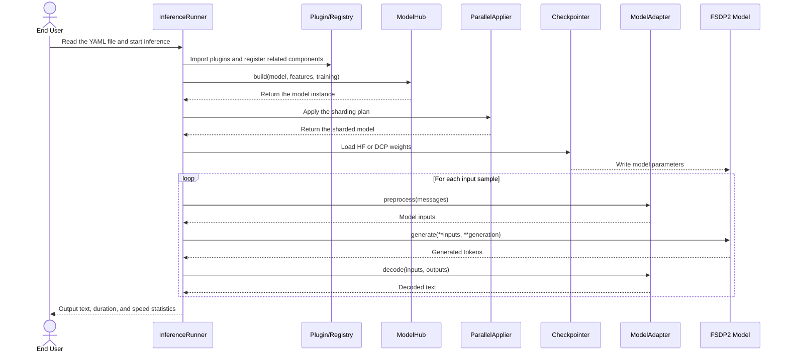

# MindSpeed MM Inference Framework User Guide

This document introduces the MindSpeed MM inference framework based on the PyTorch FSDP2 backend. It focuses on concrete inference usage examples, including the data required for inference, script configuration, and the supported scope, and describes the adaptation process for integrating a new model into the inference framework.

## Usage Example

Before running an inference task, prepare the input data and create the startup script and the corresponding configuration file. The following uses the Qwen3.5 MoE model as an example. Before running, complete the environment setup according to the model README.

### Input Data

Create `data/qwen3_5_moe_infer.json`. If you need multimodal data, change the corresponding image/video paths to the actual paths:

```json
[
  {
    "text": "Introduce yourself in one sentence."
  },
  {
    "image": "./data/demo.jpg",
    "text": "Describe this image."
  },
  {
    "video": "./data/demo.mp4",
    "text": "Summarize the main events in the video."
  }
]
```

### Startup Script

Create `examples/qwen3_5/qwen3_5_moe_inference.sh`. The configuration file path `config_path` in the script must be consistent with the actual path of the configuration file you create:

```bash
# Modify the ascend-toolkit path based on the actual environment
source /usr/local/Ascend/cann/set_env.sh
export NON_MEGATRON=true
export MULTI_STREAM_MEMORY_REUSE=2
export TASK_QUEUE_ENABLE=2
export ASCEND_LAUNCH_BLOCKING=0
export ACLNN_CACHE_LIMIT=100000
export CPU_AFFINITY_CONF=1
export PYTORCH_NPU_ALLOC_CONF=expandable_segments:True

NPUS_PER_NODE=8
MASTER_ADDR=localhost
MASTER_PORT=6000
NNODES=1
NODE_RANK=0
WORLD_SIZE=$(($NPUS_PER_NODE*$NNODES))

DISTRIBUTED_ARGS="
    --nproc_per_node $NPUS_PER_NODE \
    --nnodes $NNODES \
    --node_rank $NODE_RANK \
    --master_addr $MASTER_ADDR \
    --master_port $MASTER_PORT
"

logfile=$(date +%Y%m%d)_$(date +%H%M%S)
config_path=examples/qwen3_5/qwen3_5_moe_inference.yaml
mkdir -p logs
torchrun $DISTRIBUTED_ARGS mindspeed_mm/fsdp/inference/inference_runner.py \
    ${config_path} \
    2>&1 | tee logs/infer_${logfile}.log
```

### Configuration File

Create `examples/qwen3_5/qwen3_5_moe_inference.yaml` and replace the model path and the input data path with the actual paths:

```yaml
parallel:
  fully_shard_parallel_size: auto
  fsdp_plan:
    apply_modules:
      - model.language_model.embed_tokens
      - model.language_model
      - model.language_model.layers.{*}
      - model.language_model.layers.{*}.linear_attn
      - model.language_model.layers.{*}.mlp.experts
      - lm_head
      - mtp
    hook_modules:
      - model.language_model.layers.{*}
    param_dtype: bf16
    reduce_dtype: fp32
    reshard_after_forward: true
    num_to_forward_prefetch: 1
    num_to_backward_prefetch: 0
    cpu_offload: false
  ulysses_parallel_size: 1
  expert_parallel_size: 1
  ep_plan:
    apply_modules:
      - model.language_model.layers.{*}.mlp.experts
    dispatcher: alltoall

model:
  model_id: qwen3_5_moe
  model_name_or_path: &HF_MODEL_LOAD_PATH /path/to/Qwen3.5-MoE  # Replace with the hf weight path
  trust_remote_code: true
  attn_implementation: flash_attention_2
  gdn_implementation: ascendc
  causal_conv1d_implementation: ascendc
  use_grouped_expert_matmul: true

inference:
  load: /path/to/Qwen3.5-MoE  # Replace with the hf weight path
  load_format: auto
  init_model_with_meta_device: true
  seed: 42
  use_deter_comp: false
  adapter: qwen3_5_moe
  processor_path: *HF_MODEL_LOAD_PATH
  enable_thinking: false
  data_path: ./data/qwen3_5_moe_infer.json  # Replace with the data file path
  generation:
    max_new_tokens: 256
    do_sample: false
    repetition_penalty: 1.0
    use_cache: true
  plugin:
    - mindspeed_mm/fsdp/models/qwen3_5_moe
```

### Parameter Description

The following describes the parameters in the `inference` configuration section:

| Parameter | Type | Default | Description |
| :--- | :--- | :--- | :--- |
| `load` | string | `null` | HF or DCP weight path. |
| `load_format` | string | `hf` | Weight format to use; valid values are `hf`, `dcp`, and `auto`. With `auto`, the weight format is determined automatically from the characteristics of the `load` directory. |
| `seed` | int | `42` | Random seed, which mainly affects sampling generation and other random processing. |
| `use_deter_comp` | bool | `false` | Whether to enable deterministic computation. This helps reproduce results but may affect the performance of some operators. |
| `init_model_with_meta_device` | bool | `false` | Whether to first build an empty model on the meta device and then load the weights with the checkpointer. |
| `plugin` | List[str] | `[]` | List of model plugin paths. Plugin directories are imported recursively before the model is built, which triggers model registration. |
| `adapter` | string | `qwen3_5` | Model adapter responsible for input preprocessing, generation, and decoding. It must be consistent with a key registered in `MODEL_ADAPTERS`. |
| `processor_path` | string | — | Path to the tokenizer/processor files. |
| `enable_thinking` | bool | `false` | Whether to enable the thinking mode of the processor chat template. |
| `data_path` | string | `null` | Path to the input JSON file. |
| `generation` | dict | — | Text generation configuration, which controls generation behavior such as the maximum generation length, sampling strategy, repetition penalty, and KV cache. |

### Starting Inference

Run the following command in the repository root directory:

```bash
bash examples/qwen3_5/qwen3_5_moe_inference.sh
```

### Output

Rank 0 prints the input/output token count, generation duration, tokens/s, and decoded text of each sample, and reports the total number of samples, the total generation duration, and the average generation rate when the task ends. The following is an example of successful inference output:

```text
Inference:   0%|          | 0/3 [00:00<?, ?sample/s]
Prompt: Introduce yourself in one sentence.
Input token count: 17
Output token count: 48
Inference duration: 33.6503 seconds
Inference speed: 1.43 tokens/second
Inference result: I am Qwen3.5, the latest large language model of Tongyi Qianwen released by Alibaba. It has strong language understanding, logical reasoning, and multimodal analysis capabilities, and is committed to providing you with accurate, efficient, and creative intelligent assistant services.

Inference:  33%|███▎      | 1/3 [00:33<01:07, 33.72s/sample]
Image path: ./data/demo.jpg
Prompt: Describe this image.
Input token count: 2389
Output token count: 256
Inference duration: 125.0047 seconds
Inference speed: 2.05 tokens/second
Inference result: This image is a technical flowchart used to analyze and explain a specific error that occurs when a model is loaded in a distributed multi-process environment.

Inference:  67%|██████▋   | 2/3 [02:38<01:27, 87.52s/sample]
Video path: ./data/demo.mp4
Prompt: Summarize the main events in the video.
Input token count: 12181
Output token count: 138
Inference duration: 74.7064 seconds
Inference speed: 1.85 tokens/second
Inference result: The video shows a vibrant marine ecosystem that includes interactions among various organisms.

Inference: 100%|██████████| 3/3 [04:07<00:00, 82.45s/sample]
===== Inference Summary =====
Total processed samples: 3
Total inference duration: 233.3613 seconds
Average inference speed: 1.77 tokens/second
```

## Supported Scope

The current inference framework supports multimodal understanding models on the FSDP2 backend. The adapted and verified models are listed below:

| Backend | Model | Input Data Type | Weight Format |
| :--- | :--- | :--- | :--- |
| FSDP2 | Qwen3.5 Dense | Text, image, video | HF, DCP |
| FSDP2 | Qwen3.5 MoE | Text, image, video | HF, DCP |

To add support for a new model, follow the adaptation process described below.

## Model Adaptation

### Inference Framework

The inference framework is responsible for model construction, FSDP2 sharding, and weight loading, and invokes the model adapter `ModelAdapter` to complete inference tasks:



The model adapter `ModelAdapter` is the adaptation layer between a specific model and the generic inference flow. It is responsible for input preprocessing, generation scheduling, and output decoding. When adding a new model, you can integrate it into the unified inference framework by customizing an adapter.

### Adding an Adapter

Add a model adapter in `mindspeed_mm/fsdp/inference/adapters/<adapter_name>.py` and inherit from `ModelAdapter`:

```python
class NewModelAdapter(ModelAdapter):
    def __init__(self):
        ...

    def preprocess(self, messages: List[dict]) -> Dict[str, Any]:
        # Preprocess the data into model inputs
        ...

    def generate(self, inputs: Dict[str, Any], generation_config):
        # Call the generate method of the model and handle synchronous generation parameters across ranks
        ...

    def decode(self, inputs: Dict[str, Any], outputs: Any) -> str:
        # Remove the prompt tokens and return only the newly generated text
        ...
```

The adapter must implement the following methods:

- `preprocess`: use the tokenizer/processor to convert standardized messages into model inputs; the return value must contain `input_ids`;
- `generate`: call the model generation interface; for multi-rank inference, ensure that all ranks participate in the same generation steps;
- `decode`: remove the tokens corresponding to the input prompt from the generation result and return the decoded text.

### Registering the Adapter

In `mindspeed_mm/fsdp/inference/adapters/__init__.py`, import the new adapter and register the name used in the configuration in `MODEL_ADAPTERS`:

```python
from .adapter_name import NewModelAdapter


MODEL_ADAPTERS = {
    ...,
    "new_model": NewModelAdapter,
}
```

In the actual inference flow, you can select the corresponding adapter by setting the `inference.adapter` field in the configuration file. The field value must be consistent with a key registered in `MODEL_ADAPTERS`.

## Notes

This inference flow is only intended for effect validation and result comparison during the model training stage and has not been performance-optimized for online deployment scenarios. If your business scenario requires performance acceleration, it is recommended to use a professional inference acceleration library and the corresponding optimization components for deployment.
