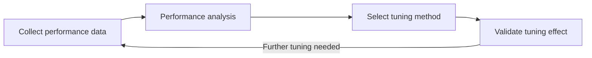

# Performance Tuning

Performance tuning is an important part of training, and reasonable performance tuning can significantly improve model training efficiency and reduce resource consumption. This document introduces how MindSpeed MM collects performance data, the analysis workflow, and common tuning methods. For the features and configurations supported by a specific model, refer to the model examples and the corresponding feature documents.

This document measures performance from the perspective of the model, focusing on the time required to complete one end-to-end training step under a specified model and input data. A step usually corresponds to one optimizer update and may contain multiple gradient-accumulation micro-batches. For multimodal samples, the text length, image resolution, and video frame count affect the amount of work, so inputs and training configurations must be kept identical when making comparisons.

The time of a training step involves the following parts:

- **Data loading**: reading images, videos, and text from storage devices, preprocessing them on the CPU (such as encoding and decoding), and transferring the data to the device.
- **Model forward and backward**: forward computation and backward gradient propagation.
- **Optimizer**: updating model parameters.
- **Model post-processing**: data processing or necessary synchronization after the optimizer update, depending on the model.
- **Communication**: data communication between devices within a node and across nodes. Communication overlapped with computation may be masked, so focus on the unmasked part during analysis.
- **Dispatch**: the process in which the host executes instructions and delivers operator tasks to the device.

These parts may run in parallel or overlap, so the accumulated durations cannot simply be added up to obtain the step time; instead, locate along the timeline the waits and the work that affect the completion of the step.

The following figure summarizes the tuning workflow in this document: first collect data, then analyze bottlenecks and select tuning methods; after implementation, verify accuracy, memory, and performance, and re-collect data for analysis when necessary.



## Collecting Performance Data

The collection entry points differ between the two backends:

- **FSDP2**: configure static collection in `tools.profile` of the training YAML. See `examples/qwen3vl/qwen3vl_30B_config_v1.yaml`.
- **Mcore (Megatron)**: configure static or dynamic collection in `mindspeed_mm/tools/tools.json`. For details, see [Profiling Tool](../../tools/tools.md#profiling-tool).

The following is an FSDP2 static collection example, merged into the existing `tools` section of the YAML:

```yaml
tools:
  profile:
    enable: true
    profile_type: static
    ranks: [0]
    static_param:
      level: level1
      with_cpu: true
      with_stack: false
      record_shapes: false
      with_memory: false
      save_path: ./profiling
      start_step: 10
      end_step: 11
      analyse_flag: true
```

The example collects one step after warm-up: the number of active steps is `end_step - start_step`, so training must run long enough. Select a stable interval and avoid operations such as initialization and checkpointing. When investigating cross-rank waiting, select the relevant ranks. `ranks: [-1]` means all ranks, but collection overhead and data volume increase as well. Enable the corresponding options only when call stacks or shape information are needed.

`with_memory` collects operator memory information, whereas `tools.memory_profile` generates allocation history snapshots, whose usage is described in [Memory Tuning](memory_tuning.md). In FSDP2, if online analysis is disabled, run `python mindspeed_mm/fsdp/tools/profiler.py --profiler-path ./profiling`; before multi-node analysis, aggregate the collection results of all machines.

## Performance Analysis Process

### Performance Analysis Tools

After the performance data is collected, you can use [MindStudio Insight](https://www.hiascend.com/document/detail/en/mindstudio/2600/GUI_baseddevelopmenttool/MindStudioInsight/docs/en/user_guide/overview.md) to analyze operator, communication, memory, and pipeline data and locate performance bottlenecks.

In multi-node scenarios, the clocks of different machines may drift, which affects the relative positions of cross-rank timelines. Before analysis, check the timeline alignment and use the single-rank or swimlane time calibration function when necessary. For details, see the [MindStudio Insight System Tuning Guide](https://www.hiascend.com/document/detail/en/mindstudio/2600/GUI_baseddevelopmenttool/MindStudioInsight/docs/en/user_guide/system_tuning.md).

### Performance Breakdown Analysis Method

After obtaining the profile data, perform a systematic breakdown along the following dimensions:

- **Computation vs. Communication vs. Free ratio**: first examine the proportions of computation, communication, and Free in the overall time. A high Free ratio usually indicates a host-bound or scheduling problem. In this case, open the **dispatch curve** (Flow Events) in the MindStudio Insight timeline: the periods where the curve is steep or shows obvious gaps are often where the host fails to dispatch in time and the NPU waits idle. By comparing these positions, the dispatch bottleneck can be located and targeted optimization can be performed (see [Scheduling Dispatch Optimization](#scheduling-dispatch-optimization)). A high communication ratio requires checking the computation-communication overlap.
- **Fast/slow rank investigation**: compare the time consumption distribution across ranks. If a certain rank is significantly slower than others in communication or dispatch, investigate whether it is dispatch-bound, load-imbalanced, or a hardware issue.
- **Operator-level breakdown**: break down the computation time by operator type (Cube/Vector/AI CPU) and identify the operator type with the largest share. For Cube operators (MatMul/FA and so on), low MFU indicates insufficient compute density; an excessively high share of Vector operators indicates room for fusion; the presence of AI CPU operators means that those operators fall back to CPU execution and are usually slow, so they should be eliminated or replaced with NPU operators.
- **Submodule MFU analysis**: calculate the MFU separately for model submodules (Attention, MLP, etc.) to precisely locate the computational bottleneck.

#### Communication Time Analysis

Analyze the proportion of communication time in the total time, focusing on the portion that is not masked by computation, which is the primary target for optimization. If communication is not sufficiently overlapped with computation, the computation-communication overlap can be improved by adjusting the prefetch timing (initiating AllGather earlier).

#### Slow/Fast Rank Troubleshooting

During large-scale cluster training, slow/fast ranks (some ranks being significantly slower than others) are a common performance bottleneck. The troubleshooting approach is as follows: (1) run the single-node script on all machines and compare performance data; (2) gradually scale up from a small cluster and use binary search to locate the slow node; (3) profile cluster data to identify the rank with the longest communication wait. Common root causes include: dispatch-bound (increased ACL interface latency on a particular rank), load imbalance (multimodal data with varying image sizes causing large differences in the ViT portion), network congestion (improper cross-block networking or HCCL algorithm configuration), and host resource contention (non-training processes on the node occupying the CPU).

When locating the issue from the communication timeline, first distinguish whether the elapsed time is **actual communication transfer** or **synchronization waiting**: if communication operators such as AllGather/ReduceScatter contain a long `notify_wait`, it indicates that this rank is already ready and is waiting for a slower rank. The root cause is usually on the slow rank (abnormal Free caused by dispatch or memory defragmentation) rather than on this rank. Adjusting the communication prefetch on this rank is unlikely to help; instead, the dispatch or memory defragmentation issue on the slow rank should be investigated and eliminated first.

In addition, **memory defragmentation** is also a common cause of prolonged Free. When memory usage is too high, the allocator must first defragment existing memory and consolidate a contiguous block before completing the allocation. This process is costly and appears on the timeline as a noticeable and prolonged Free, significantly slowing down training. During troubleshooting, it is recommended to enable memory collection together with profiling (under FSDP2, set `enable: true` in the `tools.memory_profile` section of the YAML). If the overall memory usage shows obvious rises and falls (sudden spikes and drops), it usually indicates that memory defragmentation has been triggered. Since defragmentation has a significant impact on performance, memory usage should be reduced, for example by lowering the sequence length or increasing the number of ranks.

#### MFU Decomposition Analysis

Model FLOPS Utilization (MFU) refers to the ratio of the FLOPS actually achieved during training to the theoretical peak FLOPS of the hardware. It reflects the degree to which hardware computing power is effectively utilized and is a commonly used metric for measuring computational efficiency. By decomposing MFU by model submodule (such as Attention and MLP) and by stage (forward, backward, and recomputation), the computational bottleneck can be precisely located.

The analysis steps are as follows:

- **Calculate theoretical FLOPS**: based on the model structure and input shape, calculate the theoretical FLOPS of each module separately.
- **Obtain actual elapsed time**: extract the actual elapsed time of each module in the forward and backward stages from the profile data.
- **Calculate the submodule MFU**: `submodule MFU = submodule FLOPS/(submodule time × theoretical compute capacity)`.
- **Compare and locate the bottleneck**: compare the MFU values of each submodule to identify modules with low utilization.

In practice, the MFU of different submodules often has structural causes: Attention layers consist mainly of dense matrix multiplications (such as Flash Attention), so their MFU is usually high; MoE expert layers contain non-computational operations such as permute/unpermute, so their MFU is usually low. When interpreting the breakdown results, the key is to distinguish "structurally low" (for example, MoE routing itself contains a large amount of non-computational overhead and is hard to change) from "optimizable low" (for example, fusable Vector operators, redundant Casts, and inefficient memory access). Only the latter are optimization targets. The purpose of optimization is to eliminate this waste and improve real performance with appropriate means, not to inflate the MFU number itself.

## Performance Tuning Methods

MindSpeed MM provides a variety of performance tuning features, and you can choose an appropriate strategy based on the actual scenario. For detailed usage of each feature, see the corresponding document in the [Feature List](../../features/feature_list.md). Some features are bound to a specific training backend, so confirm the backend in use before applying them.

### Common Features of Both Backends

The following framework features are supported by both FSDP2 and Mcore:

#### Memory Optimization

Recomputation trades additional computation for memory; [Async Activation Offload](../../features/memory/async_activation_offload.md) offloads activations to the host; [ChunkLoss](../../features/optimization/chunkloss.md) computes the loss in chunks. For the applicable models, configurations, and costs, see the document of each feature.

#### Fused Operator

Multiple consecutive small operators are fused into a single large operator (such as RotaryMul, RmsNorm, and SwiGlu) to reduce kernel launch overhead and memory bandwidth consumption. The use of fused operators is automatically applied by the framework, requiring no manual configuration by users.

#### CPU Core Binding

TorchNPU provides the `CPU_AFFINITY_CONF` environment variable to control CPU-side core binding and reduce context switches and cross-NUMA latency: `0` or unset means disabled; `1` enables coarse-grained core binding; `2` enables fine-grained core binding. After core binding is enabled, you can optionally define custom binding ranges for specific NPU devices, for example `export CPU_AFFINITY_CONF=1,npu0:192-215,npu1:216-239,npu2:0-23,npu3:24-47`. For details, see [Environment Variable Reference](https://www.hiascend.com/document/detail/en/Pytorch/730/comref/EnvVariables/docs/en/environment_variable_reference/CPU_AFFINITY_CONF.md).

#### Scheduling Dispatch Optimization

When host-side operator dispatch becomes a bottleneck (large Free segments in profiling with no tasks executing on the CPU side), the following TorchNPU environment variables can be tried:

| Environment Variable | Purpose | Recommended Value |
|----------|------|--------|
| `TASK_QUEUE_ENABLE` | Controls the operator dispatch queue optimization level | `2` (enable level-2 optimization) |
| `ACLNN_CACHE_LIMIT` | Upper limit on the number of cached operators | `100000` |
| `PYTORCH_NPU_ALLOC_CONF` | Controls the cache allocator behavior | `expandable_segments:True` (enable virtual memory) |
| `ASCEND_LAUNCH_BLOCKING` | Whether to force synchronous operator dispatch (for debugging) | Use `0` or leave unset for normal training; temporarily set to `1` when locating the faulty operator or obtaining an accurate stack trace (this synchronously blocks dispatch and slows down training, and should be reverted after debugging) |

#### Python GC Issues

Python's garbage collection (GC) mechanism may cause training performance jitter. When periodic performance degradation is observed and profiling shows large segments of Free, you can try adjusting the GC threshold with `gc.set_threshold(700, 10, 10000)`, proactively calling `gc.collect()` after saving checkpoints, and in extreme scenarios, attempting `gc.disable()` while being mindful of the memory leak risk.

### FSDP2 Backend Features

The following methods apply to the pluggable FSDP2 backend. For the specific configuration and applicable models, refer to the [FSDP2 Migration Guide](../development/fsdp2_model_migration_guide.md) and the model examples.

#### Memory and Host Memory Optimization

- **Recomputation**: select the recomputation modules in the `features` section through `recompute` and `recompute_plan.apply_modules`, trading additional computation for memory space.
- **Swap Core**: [Swap Core](../../features/memory/swap_core.md) manages, in a unified way, the device memory, host page-locked memory, and prefetch policy used for tensor swap-in and swap-out. Configuring only `swap_plan` does not enable offloading and must be used together with features such as Act Stash or Op Replay.
- **Act Stash**: [Act Stash](../../features/memory/act_stash.md) uses Swap Core to offload the activations saved during forward and retrieve them on demand during backward: set `enable_activation_offload: true` and `activation_offload_plan.impl: stash`, and specify `apply_modules`. It is an either-or choice with the `legacy` implementation of the existing async activation offload; evaluate it together with peak memory, host memory, and copy overhead.
- **Op Replay**: cache the outputs of specified operators within the recomputation scope, and retrieve the outputs during backward recomputation to skip recomputing those operators. Recomputation must be enabled, `recompute_plan.use_reentrant: false` must be set, and `op_replay_scopes` must be configured; the scope must be covered by the recomputation modules. When enabled together with Act Stash, they share the Swap Core capacity. For applicable scenarios and constraints, see [Op Replay](../../features/optimization/op_replay.md).
- **CCE Loss**: [ChunkLoss](../../features/optimization/chunkloss.md) in FSDP2 supports the CCE implementation, which computes cross-entropy in vocabulary chunks to reduce the memory overhead caused by full logits. Enable it through `features.enable_chunk_loss: true` and `chunkloss_plan.impl_type: cce`, and adjust the vocabulary chunk size with `vocab_tile_size`. Currently `default` and `per_token_loss` are supported, while output layers with bias and dynamic ChunkLoss are not. Use it together with the model configuration and accuracy verification.
- **ChunkMBS**: when parameter gathering overhead is high and memory limits the batch size, chunking along the batch dimension allows multiple micro-chunks to be computed after a single parameter gathering. Both recomputation and async activation offload must be enabled at the same time, and the `apply_modules` of ChunkMBS must be covered by both. For the configuration and constraints, see [ChunkMBS](../../features/optimization/chunkmbs.md).
- **Meta Device initialization**: set `training.init_model_with_meta_device: true` to construct the model structure on the meta device first and reduce host memory usage during initialization. For applicability, see the model examples.

#### Communication and Computation Optimization

- **Prefetch**: initiate parameter AllGather in advance to try to mask communication with computation. `parallel.fsdp_plan.num_to_forward_prefetch` and `num_to_backward_prefetch` control the number of explicitly prefetched layers for forward and backward respectively, both defaulting to `0`. Automatic prefetch is derived from the order of `apply_modules`, so the configuration should match the forward execution order of the model; a model may also customize prefetching. Check the actual order against logs and timelines, and watch the memory overhead introduced by prefetching. When expert parallelism (EP) is enabled, also check whether AllGather and All2All contend for bandwidth.
- **Reshard after forward**: `parallel.fsdp_plan.reshard_after_forward` defaults to `true`, resharding the parameters after forward to save memory at the cost of gathering them again during backward. Setting it to `false` reduces backward gathering at the cost of higher memory usage. This general configuration applies to the modules managed by the plan, and communication time and peak memory should be compared together when adjusting it.
- **Sharding granularity**: specify the sharded modules through `parallel.fsdp_plan.apply_modules`. Finer granularity may increase the number of communication calls, while coarser granularity may increase peak memory or affect compute-communication overlap; choose based on the model structure and the timeline.
- **Ulysses context parallelism**: partition the sequence computation through `parallel.ulysses_parallel_size`, which reduces the per-rank sequence computation and memory pressure while introducing communication overhead. For the configuration and constraints, see [Unaligned Ulysses CP](../../features/parallel/unaligned_ulysses_cp.md).
- **Cast optimization**: check the precision conversions that appear frequently in the model, confirm the input, output, and accumulation precisions supported by the operators with the model implementation and the TorchNPU version, and then decide whether redundant Casts can be removed. Verify accuracy and training results after the change; the gain varies by model.

### Mcore (Megatron) Backend Features

- **Heterogeneous parallelism**: combine parallel strategies across different dimensions. For details, see [Heterogeneous Parallelism](../../features/parallel/hetero_parallel.md).
- **Sequence parallelism**: choose algorithms such as Ulysses, RingAttention, or USP according to the model and sequence length. For details, see [DiT USP](../../features/parallel/dit_usp.md) and [DiT Ring Attention](../../features/parallel/dit_ring_attention.md).
- **Fused operators and communication hiding**: fused operators such as RMSNorm, SwiGLU, and Flash Attention, together with weight update communication hiding, can be used in combination with the model configuration. For details, see the [Migration and Tuning Guide](../development/model-migration.md#performance-tuning).
