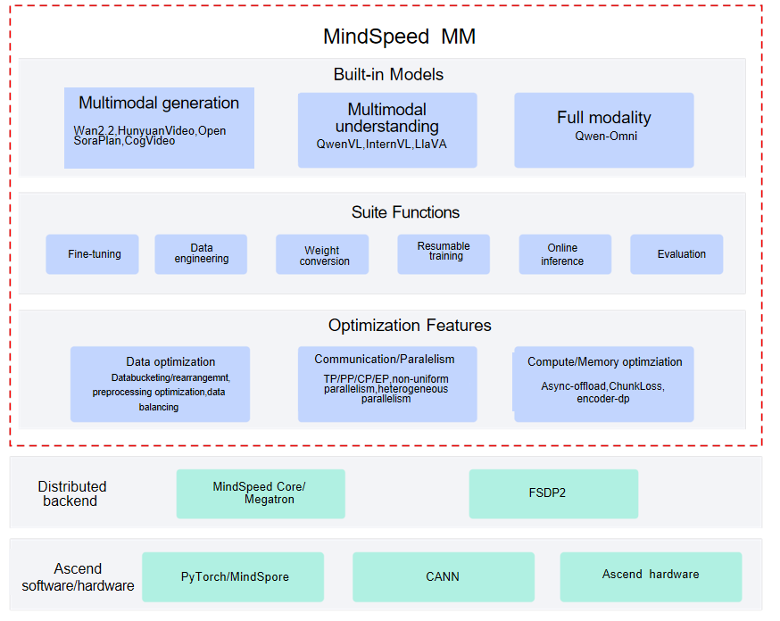

# Introduction

## Overview

MindSpeed MM is an Ascend multimodal large model suite for large-scale distributed training that supports both multimodal generation and multimodal understanding. It aims to provide an end-to-end multimodal training solution for Huawei Ascend chips and includes preset mainstream industry models, data engineering, distributed training and acceleration, and features such as pre-training, fine-tuning, and online inference tasks.

## MindSpeed MM Architecture

The overall architecture of the MindSpeed MM Ascend multimodal training solution is shown in the following figure. It is divided into three layers:

- Ascend basic software and hardware. This includes hardware such as Ascend AI processors and Ascend servers, which provide powerful parallel computing power for massive multimodal data computation and model training; Compute Architecture for Neural Networks (CANN), as the software engine of Ascend AI processors, provides highly optimized basic operators and communication libraries (e.g., HCCL); PyTorch + TorchNPU supports the mainstream PyTorch deep learning framework in the industry and seamlessly connects PyTorch operations to Ascend hardware through the TorchNPU plugin, enabling developers to use familiar programming paradigms and APIs and leverage the computing power advantages of Ascend

- Distributed backend. This includes dual backend support for the distributed training frameworks MindSpeed Core/Megatron and FSDP2, and provides efficient distributed training capabilities, including multiple parallel strategies such as data parallelism, model parallelism, and hybrid parallelism, supporting the training and optimization of large-scale models.

- MindSpeed MM. This provides full-process capabilities such as multimodal data processing, model construction, and distributed training, fully leveraging the advantages of Ascend hardware and supporting efficient training and deployment of large-scale multimodal models.
The architecture relationships of MindSpeed MM are shown in the following figure

Figure 1 MindSpeed MM Architecture

## Features

The MindSpeed MM components consist of preset models, suite features, and multimodal optimization features

 Mainstream open source multimodal models are ready to use out of the box: more than 20 mainstream models are supported, such as generative models like Wan and HunyuanVideo, understanding models like QwenVL and InternVL, and omni-modal models like Qwen-Omni. Startup scripts for pre-training, fine-tuning, evaluation, and online inference of multimodal generation, understanding, and omni-modal models are provided, so users can start training tasks with a single command.

 Rich functional components: these are divided into high-level abstract classes (assembly classes), atomic model classes, and common components. SoRAModel, VLModel, and TransformersModel are the high-level wrapper classes for multimodal generation, understanding, and Transformers models respectively; in addition, there are basic atomic classes such as text_decoder, audio, and dit; the common components include general-purpose components such as norm, rope, embedding, and spec. A complete toolchain covering the model lifecycle is provided, including data preprocessing and engineering, large-scale pre-training, instruction fine-tuning and domain adaptation, model weight conversion, high-performance online inference, and comprehensive automated evaluation.

 Multimodal acceleration features: these include multi-dimensional efficient parallel algorithms (DP/PP/TP/CP/EP/FSDP2), computation-communication overlap, multimodal load balancing, dynamic memory management (recomputation and tiered storage), and long sequence optimization, ensuring maximum training efficiency.

## Dual Backend Support of MindSpeed MM

MindSpeed MM supports two types of training backends: the FSDP2 backend based on PyTorch FSDP2 and the Megatron backend based on MindSpeed Core (that is, the Megatron-LM kernel). The FSDP2 backend is recommended for new models.

### FSDP2 Backend

The MindSpeed MM FSDP2 backend is built on PyTorch FSDP2 and adds Ascend-oriented capabilities such as parallel state management, model registration, data registration, DCP checkpoints, recomputation, LoRA, expert parallelism, and multimodal data processing. This backend runs with an independent training entry and a single YAML configuration, does not depend on Megatron command-line arguments, and has been applied to the training of multiple open source multimodal models, including Wan2.2 and Qwen3VL.

### Megatron Backend

The Megatron backend adopts the PTD (Pipeline, Tensor, Data) parallel scheme and supports features such as heterogeneous parallelism, sequence parallelism (Ulysses, RingAttention, USP), fused operators, and communication hiding for Megatron weight updates. This backend reuses the Megatron training entry, and the training script needs to define arguments such as `GPT_ARGS`, `MM_ARGS`, and `OUTPUT_ARGS` to pass the Megatron argument verification.
