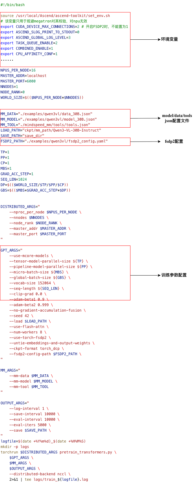
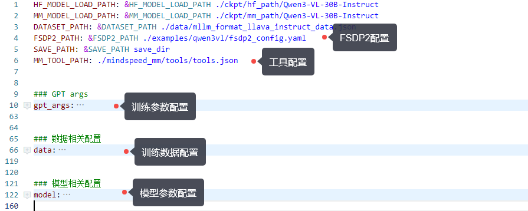

# Configuration Overview

## Applicable Backends

This document applies to the Mcore and Mcore-FSDP2 backends.

The configuration parameters of MindSpeed MM mainly include `model configuration`, `data configuration`, `fsdp2 configuration`, `training arguments`, `tool configuration`, and `environment variables`.

<!-- - [Model Configuration](<>)
- [Data Configuration](<>)
- [Training Arguments](<>)
- [FSDP2 Configuration](<>)
- [Tool Configuration](<>)
- [Environment Variables](<>) -->

## Configuration Entry Points

All configuration entry points are in the bash files of the training/inference scripts or in the related parameter configuration yaml files. 
<!-- Take `examples/qwen3vl/finetune_qwen3vl_30B.sh` as an example: -->

<!-- The configuration entry point in the bash script is as follows:



The configuration yaml file is as follows:

 -->

## Configuration Parsing

### Parameter Parsing

The configuration parsing entry point for the `model, data, tools` parameters is `mindspeed_mm/configs/config.py`. The main classes and functions are as follows:

- `ConfigReader`: converts a dictionary into easily accessible object attributes, automatically and recursively converting json configurations or yaml parameters into a ConfigReader object, and provides a `to_dict()` interface to convert the object back into a `dict`
- `MMConfig`: uniformly loads and manages multiple JSON configuration files
- `merge_mm_args`: merges the model, data, and tools configurations into Megatron's `global_args`

How can these configurations be obtained in code? You can use Megatron's global `args`:

```Python
from megatron.training import get_args args = get_args()
mm_model, mm_data = args.mm.model, args.mm.data
```

### FSDP2 Configuration Parsing

The entry function for FSDP2 initialization is [torch_fully_sharded_data_parallel_init](https://gitcode.com/Ascend/MindSpeed/blob/master/mindspeed/core/distributed/torch_fully_sharded_data_parallel/torch_fully_sharded_data_parallel_adaptor.py#L209).

```python
def torch_fully_sharded_data_parallel_init(
    self,
    config: TransformerConfig,
    ddp_config: DistributedDataParallelConfig,
    module: torch.nn.Module,
    disable_bucketing: bool = False,
    sub_modules_to_wrap: Set[torch.nn.Module] = {
        TransformerLayer,
        LanguageModelEmbedding,
        RotaryEmbedding,
    },
    process_group: Optional[ProcessGroup] = None,
):
......
# If the module has its own 'fully_shard' method, use it directly
unwrapped_model = unwrap_model(self.module)
if hasattr(unwrapped_model, 'fully_shard') and callable(getattr(unwrapped_model, 'fully_shard')):
    execute_result = unwrapped_model.fully_shard(
        process_group=self.process_group,
        fsdp2_config_path=ddp_config.fsdp2_config_path,
    )
    if execute_result:
        return 
......
```

When the model has implemented the `fully_shard` interface itself, this function hands the FSDP2 initialization directly to the model. It is strongly recommended to initialize the FSDP2 configuration by inheriting from `FSDP2Mixin`.

`FSDP2Mixin` (`mindspeed_mm/models/transformers/base_model.py`)
is the Mixin class for FSDP2 configuration parsing and strategy implementation in the MM repository. Its main logic is in the `fully_shared` interface, which includes `_pre_fully_shared`, `_fully_shared`, and `_post_fully_shared`.

- `_pre_fully_shared`: reads `fsdp2_config.yaml` and parses it into `FSDPConfig` and `config`.
- Creates `device_mash`
- `_fully_shared`: applies FSDP2-related wrappers.
- `_post_fully_shared`: includes `init_weight`, `meta_init`, etc.
